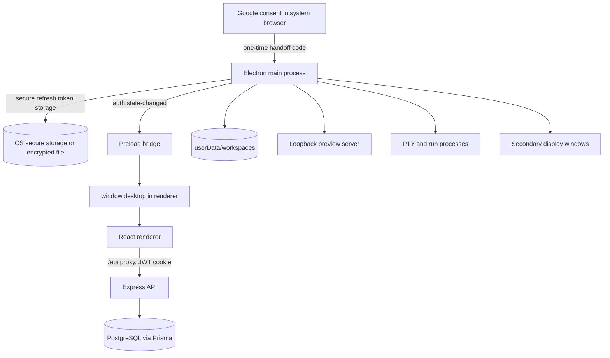

# Electron desktop documentation

Vinkup’s desktop app is an Electron shell around the same React renderer and Express API used by the
web app. The main process owns the browser window, authentication tokens, local task workspaces,
preview server, terminals, run processes and native dialogs. The renderer talks to it through a
context-isolated `window.desktop` bridge and uses the same REST proxy for application data.

These pages document the **implemented** desktop behavior. Source code takes priority over older
prose: the authoritative API types are in `packages/types/src/desktop.ts`, the bridge is in
`desktop/src/preload/index.ts`, and the main-process implementation is in `desktop/src/main/`.

## Start here

| Order | Document                                                     | What it covers                                                                                                                      |
| ----: | ------------------------------------------------------------ | ----------------------------------------------------------------------------------------------------------------------------------- |
|     1 | [Authentication](auth.md)                                    | Why the web cookie flow changed, the browser-based Google OAuth handoff, PKCE, token storage, refresh and the `auth:*` IPC channels |
|     2 | [Window and display management](window.md)                   | `window.desktop.window`, fullscreen, secondary displays, overlays, focus alerts, screen lock and PDF dialogs                        |
|     3 | [Local workspace, preview, terminals and runs](workspace.md) | `workspace:*`, `terminal:*`, `run:*`, `lighthouse:run`, file mirroring, esbuild preview, PTY, PostgreSQL and REST code autosave     |
|     4 | [Users, roles and assignments](users.md)                     | Three roles, server guards, `/api/admin` vs `/api/manager`, account provisioning and Prisma relations                               |
|     5 | [Course, day, task and review workflow](course_workflow.md)  | Curriculum, day locks, code save/submit, task review, integrity, certificates and AI assistance                                     |
|     6 | [Leave requests](leave_request.md)                           | Trainee requests, Mentor/Manager decisions, append-only history, unread counts and Slack messages                                   |
|     7 | [Slack integration](slack.md)                                | Per-mentor channel IDs, shared bot, outbox worker, retries and notification text                                                    |

## Application-level context

| Document                                               | Why desktop readers need it                                                                             |
| ------------------------------------------------------ | ------------------------------------------------------------------------------------------------------- |
| [Setup guide](../setup-guide.md)                       | Environment variables, database and desktop dev/build commands                                          |
| [Architecture overview](../architecture-overview.md)   | Frontend/backend layers and hosting                                                                     |
| [API reference](../api-specifications.md)              | Every REST endpoint, request and response                                                               |
| [Database](../database.md)                             | Schema and data dictionary                                                                              |
| [Roles and assignments](../roles-and-assignments.md)   | Background for mentor assignment and authorization                                                      |
| [Task review workflow](../task-review-workflow.md)     | Historical review narrative; use [course workflow](course_workflow.md) for current limits and endpoints |
| [Leave request workflow](../leave-request-workflow.md) | Historical leave narrative; use [leave requests](leave_request.md) for current behavior                 |
| [Slack integration](../slack-integration.md)           | Shared background for [desktop Slack](slack.md)                                                         |
| [Certificate security](../certificate-security.md)     | Signed certificates and verification                                                                    |
| [Conventions](../conventions.md)                       | Code style, commits and review expectations                                                             |

## Architecture at a glance



- The renderer receives `DesktopAuthState` (`status`, `user: MeResponse | null`, `error`,
  `persistent`) but never a refresh token.
- Application data such as task code, submissions, leave requests and user lists still lives in
  PostgreSQL and is read through the REST API. The local workspace folder is the runtime copy.
- In development, Electron loads the Vite frontend at `http://localhost:5173` and that dev server
  proxies `/api` to the backend. In a packaged build, Electron starts a loopback static server on
  `127.0.0.1:${VINKUP_DESKTOP_PORT}` and proxies `/api` from there.
- Production API URL is `https://vinkup-electron.onrender.com`; development uses
  `http://localhost:3000`.
- Secondary display windows receive `window.vinkupDisplay`; alert windows receive
  `window.displayAlert.choose('back' | 'exit')`. They do not expose the full `window.desktop` API.

## Configuration

| Variable / default                                                                                        | Purpose                                                                                                                                              |
| --------------------------------------------------------------------------------------------------------- | ---------------------------------------------------------------------------------------------------------------------------------------------------- |
| `VINKUP_API_URL` — production `https://vinkup-electron.onrender.com`, development `http://localhost:3000` | REST API target                                                                                                                                      |
| `VINKUP_DESKTOP_PORT` — `43110`                                                                           | Fixed origin for the packaged app’s loopback renderer server (`http://127.0.0.1:43110`); development uses the Vite server on `http://localhost:5173` |
| `VINKUP_RESOURCES_ALLOWLIST_URL` — `<api>/api/resources/allowlist`                                        | Override the resources allowlist URL; see [workspace](workspace.md#resources-browser-and-allowlist)                                                  |
| `VINKUP_DISABLE_SCREEN_PROTECTION` — exact `true` or `false`                                              | Development-only protection override; other values are ignored                                                                                       |

Desktop source layout:

```text
desktop/
├── src/main/                 Electron app lifecycle, IPC handlers, display windows,
│   └── workspace/            workspace manager, files, PTY, processes, environment, PostgreSQL, preview
├── src/preload/index.ts      contextBridge: window.desktop, window.vinkupDisplay, window.displayAlert
└── electron.vite.config.ts   main, preload and renderer build configuration
```

## Desktop commands

Run from the repository root:

```bash
npm run dev:desktop      # Vite dev server + Electron in development
npm run build:desktop    # type-check and build the desktop app
npm run start:desktop    # start the built app
npm run dist:desktop     # produce distributable packages
```

See the [setup guide](../setup-guide.md) for prerequisites and environment files.

## Current limitations

- Linux `basic_text` secure storage is a file, not an OS keyring. `DesktopAuthState.persistent`
  reports which backend was used.
- Native fullscreen events are exposed through IPC, but the renderer still uses browser fullscreen
  tracking for focus behavior.
- Time spent on a task is sent as capped heartbeats; there is no activity-time flush on app quit.
- Mentor/admin UI routes are hidden by `RoleRoute`, but server guards remain the security boundary.
- Local Node and PostgreSQL runtimes require the desktop app. The browser build keeps the in-browser
  runtimes.
