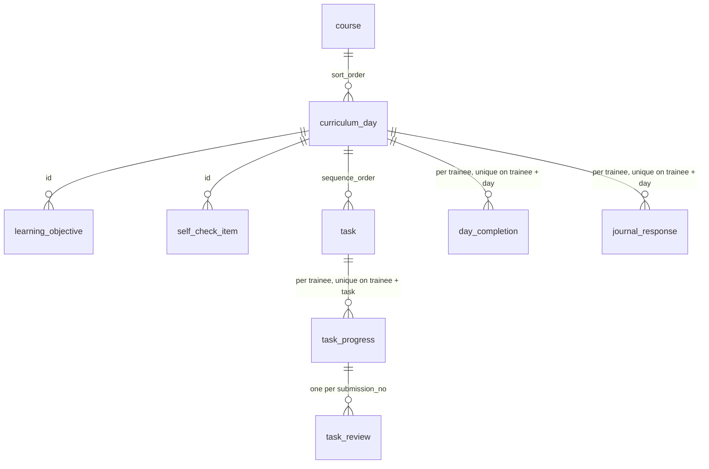
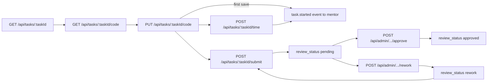
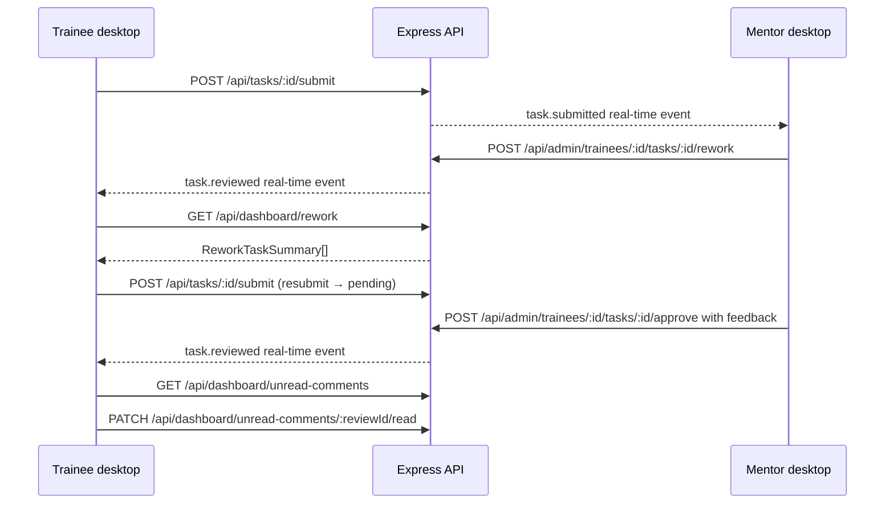

# Course, day, task and review workflow

The Electron app runs the same React renderer as the web app. Course progress, code snapshots,
submissions, mentor decisions and integrity scores all come from the Express API; the desktop shell
adds the local folder, preview server and terminal described in [workspace](workspace.md), plus
fullscreen/overlay, focus and screen-lock protection that emits integrity flags. This document
follows the implementation in
`backend/src/module/dashboard-module/`, `backend/src/module/day-module/`,
`backend/src/module/task-module/`, `backend/src/module/review-module/`,
`backend/src/module/progress-module/`, `backend/src/module/ai-review-module/` and
`packages/types/src/`. See the [API reference](../api-specifications.md) for the wider endpoint list
and [roles and assignments](users.md) for who may call each route.

## Curriculum data model



- `course` IDs are slugs (`html`, `css`, `js`, `ts`, `node`, `postgresql`, `prisma`, `react`) with a
  unique `sort_order`. `curriculum_day` IDs are strings such as `css-day-03`, unique per
  `(course_id, day_number)`. Task IDs are slugs such as `css-day-03-t-2`, unique per
  `(curriculum_day_id, sequence_order)`.
- Curriculum content is seeded by `backend/src/lib/seed.ts` from
  `backend/prisma/seed-data/curriculum.json`; the database is the source of truth for tasks and
  progress.
- `task.runtime` is `browser | node | sql`. The frontend uses that value, plus `run_command` and
  `setup_sql`, to choose the desktop runtime.
- `task_progress` is unique on `(trainee_id, task_id)`. It holds the latest working `files`, the
  submitted snapshot `submitted_files`, `status`, `review_status`, `submission_count`,
  `time_spent_seconds` and timestamps.
- `task_review` is append-only and unique on `(trainee_id, task_id, submission_no)`. Past decisions
  are never overwritten.

## Day lock and completion rule

`ProgressService.isDayUnlocked()` is the only definition of the lock rule. A day is unlocked when it is
already completed, when it is the first day in curriculum order, or when the preceding day is
completed. Unknown day IDs are rejected before lock checks. Interactive and state-changing endpoints
enforce the rule; `GET /api/days/:dayId` still serves lesson content and
`GET /api/days/:dayId/status` reports `isLocked` for a locked day. The UI only reflects the server’s
decision.

A day can be submitted when all **non-stretch** tasks for that day have `task_progress.status =
'completed'` (meaning submitted at least once). Stretch goals do not block completion. Completing a day
is idempotent and returns the next day ID in curriculum order.

| Method | Endpoint                      | Response                                      |
| ------ | ----------------------------- | --------------------------------------------- |
| GET    | `/api/dashboard`              | `DashboardResponse`                           |
| GET    | `/api/courses/:courseId/days` | `CourseDaysResponse`                          |
| GET    | `/api/days/:dayId`            | `DayContent`                                  |
| GET    | `/api/days/:dayId/status`     | `DayCurrentStatus`                            |
| PATCH  | `/api/days/:dayId/complete`   | `CompleteDayResponse`                         |
| PATCH  | `/api/days/:dayId/status`     | `DayCurrentStatus` (legacy alias of complete) |

`PATCH /api/days/:dayId/status` is a legacy compatibility alias; the current frontend calls
`PATCH /api/days/:dayId/complete` (`frontend/src/api/days.ts`). Both call the same service. A locked
day returns `403 DAY_LOCKED`; an incomplete checklist returns `403 CHECKLIST_INCOMPLETE` with
`completedTasks` and `requiredTasks` in `error.details`.

```ts
type DayStatus = 'LOCKED' | 'UNLOCKED' | 'COMPLETED';
type DayCurrentStatus = { isLocked: boolean; isCompleted: boolean };
type CompleteDayResponse = { status: DayCurrentStatus; nextDayId: string | null };

type DayContent = {
  dayId: string;
  courseSlug: string;
  courseTitle: string;
  dayNumber: number;
  totalDays: number;
  title: string;
  subtitle: string;
  lessonSummary: string;
  learningObjectives: { id: string; code: string; title: string; description: string }[];
  selfCheckItems: {
    id: string;
    code: string;
    label: string;
    description: string;
    isRequired: boolean;
  }[];
  journalPrompt: string;
};

type DaySummary = {
  id: string;
  courseId: string;
  dayNumber: number;
  title: string;
  description: string;
  status: DayStatus;
};

type DashboardResponse = {
  nextDay: (DaySummary & { courseTotalDays: number }) | null;
  totalDaysCompleteOverall: number;
  totalDaysOverall: number;
  today: { activeSeconds: number; codingSeconds: number };
  total: { activeSeconds: number; codingSeconds: number };
  typing: TypingSummaryResponse;
  completedCourseIds: string[];
};
```

**Current frontend limitation:** `DayOverviewPage.tsx` still renders static `mockDayContents[dayId]`
for lesson text and objectives, although `GET /api/days/:dayId` exists in the backend. Day status,
task list, journal and integrity use the REST endpoints above. Do not treat the static map as an API
contract.

## Task lifecycle



The desktop app mirrors the same editor state to a local folder for preview and terminal runs (120 ms
debounce) and to `PUT /api/tasks/:taskId/code` for the persisted copy (2 s debounce, 8 s max wait, 5 s
retry). See [workspace](workspace.md). A submission reviews the REST snapshot, not the local folder.

### Trainee task endpoints

All `/api/tasks` endpoints require `requireTrainee` and only address the signed-in trainee’s own
progress. `taskId` must match `/^[a-z0-9-]+$/` and be at most 100 characters.

| Method | Endpoint                     | Request                     | Response                       |
| ------ | ---------------------------- | --------------------------- | ------------------------------ |
| GET    | `/api/tasks/:taskId`         | —                           | `TaskResponse`                 |
| GET    | `/api/tasks/:taskId/code`    | —                           | `TaskCodeResponse`             |
| PUT    | `/api/tasks/:taskId/code`    | `SaveCodeRequest`           | 204, no body                   |
| POST   | `/api/tasks/:taskId/time`    | `{ deltaSeconds: integer }` | `{ timeSpentSeconds: number }` |
| POST   | `/api/tasks/:taskId/submit`  | —                           | `SubmitTaskResponse`           |
| GET    | `/api/tasks/:taskId/review`  | —                           | `TaskReviewSummary`            |
| GET    | `/api/tasks/:taskId/reviews` | —                           | `TaskReview[]`                 |

```ts
type ReviewStatus = 'pending' | 'approved' | 'rework';
type TaskStatus = 'not_started' | 'in_progress' | 'completed';
type TaskRuntime = 'browser' | 'node' | 'sql';
type TaskFile = { path: string; content: string };

type TaskResponse = {
  id: string;
  title: string;
  instructionsMarkdown: string;
  isStretchGoal: boolean;
  sequenceOrder: number;
  estimatedMinutes: number | null;
  status: TaskStatus;
  reviewStatus: ReviewStatus | null;
  submissionCount: number;
  timeSpentSeconds: number;
  day: { id: string; dayNumber: number; courseTitle: string };
  runtime: TaskRuntime;
  runCommand: string | null;
  setupSql: string | null;
};

type TaskCodeResponse = { files: TaskFile[]; updatedAt: string | null };
type SaveCodeRequest = { files: TaskFile[] };
type SubmitTaskResponse = {
  status: 'completed';
  submittedAt: string;
  reviewStatus: ReviewStatus; // always 'pending' after a submit
  submissionCount: number;
};
type TaskReview = {
  id: string;
  taskId: string;
  adminId: string;
  adminName: string;
  submissionNo: number;
  decision: 'approved' | 'rework';
  feedback: string;
  reviewedAt: string;
};
type TaskReviewSummary = {
  reviewStatus: ReviewStatus | null;
  submissionCount: number;
  latestReview: TaskReview | null;
};
```

Save and submit rules:

- `GET /api/tasks/:taskId/code` returns the trainee’s working files, or the task’s starter files
  before the first save.
- `PUT /api/tasks/:taskId/code` accepts at most **200 files**, each path at most **200 characters**
  and each file at most **200,000 characters**. Paths use `/`, are relative, and contain no empty,
  `.` or `..` segments. Duplicate paths, NUL and unpaired surrogate halves are rejected. A first
  save publishes `task.started` to the assigned mentor.
- `POST /api/tasks/:taskId/time` accepts `deltaSeconds` from 0 to 3600. The server floors it and caps
  a positive heartbeat at **300 seconds** before adding it to `time_spent_seconds`. A zero delta
  returns the stored total without writing. The first positive heartbeat on a new progress row also
  publishes `task.started`.
- `POST /api/tasks/:taskId/submit` copies working files to `submitted_files`, increments
  `submission_count`, sets `status = 'completed'` and `review_status = 'pending'`. Editing stays
  unlocked after submission; an approved task cannot be resubmitted and returns `409 ALREADY_APPROVED`.
  Each new submission queues a Slack task notification for the assigned mentor when configured and
  enabled, and publishes `task.submitted` in the app.
- Every task read/save/submit first checks that the task exists and its parent day is unlocked:
  unknown task gives `404 NOT_FOUND`, locked day gives `403 DAY_LOCKED`.

### Mentor review endpoints

These routes are mounted under `/api/admin` behind `requireMentor` plus
`requireAssignedTrainee`, so only the trainee’s currently assigned mentor may use them.

| Method | Endpoint                                               | Request                 | Response               |
| ------ | ------------------------------------------------------ | ----------------------- | ---------------------- |
| POST   | `/api/admin/trainees/:traineeId/tasks/:taskId/approve` | optional `{ feedback }` | `TaskReview` (201)     |
| POST   | `/api/admin/trainees/:traineeId/tasks/:taskId/rework`  | `{ feedback }`          | `TaskReview` (201)     |
| GET    | `/api/admin/trainees/:traineeId/tasks/:taskId/reviews` | —                       | `TaskReview[]`         |
| GET    | `/api/admin/trainees/:traineeId/feedback`              | —                       | `AdminFeedbackEntry[]` |
| GET    | `/api/admin/trainees/:traineeId/tasks/:taskId/code`    | —                       | `AdminTaskCode`        |

Feedback is trimmed and capped at **10,000 characters**. Rework requires non-empty feedback; approval
allows an omitted body and stores `''` when no note is given. Older prose that says 5,000 characters
is stale — the Zod schema in `backend/src/module/review-module/review.schema.ts` is authoritative.

A decision may only target a submission still waiting for review. No submission gives
`409 TASK_NOT_SUBMITTED`; an already approved or reworked attempt gives `409 ALREADY_REVIEWED`. The
check is repeated inside a transaction so two mentors cannot judge the same attempt. After a rework
decision the trainee must resubmit the task; trying to approve or rework the reworked attempt again
returns `409 ALREADY_REVIEWED`. A successful decision publishes `task.reviewed` to the trainee’s open
session; the trainee review history is append-only.

`AdminTaskCode` contains `taskId`, `title`, `sequenceOrder`, `isStarterCode`,
`instructionsMarkdown`, `status`, `reviewStatus`, `submissionCount`, `timeSpentSeconds`, `files` (the
latest **submitted** files, never the live working copy), `codeUpdatedAt` and `lastSubmittedAt`.
Mentors can read it for a trainee assigned to them; see [users](users.md).

## Journal and integrity

The journal is optional and stored per `(trainee_id, curriculum_day_id)`.

| Method | Endpoint                     | Request            | Response               | Errors                                |
| ------ | ---------------------------- | ------------------ | ---------------------- | ------------------------------------- |
| GET    | `/api/days/:dayId/journal`   | —                  | `DayJournal`           | `401`, `403 DAY_LOCKED`, `404`        |
| PUT    | `/api/days/:dayId/journal`   | `{ responseText }` | `DayJournal`           | `400`, `401`, `403 DAY_LOCKED`, `404` |
| GET    | `/api/journal`               | —                  | `JournalListResponse`  | `401`                                 |
| GET    | `/api/days/:dayId/tasks`     | —                  | `DayTask[]`            | `401`, `403 DAY_LOCKED`               |
| GET    | `/api/days/:dayId/integrity` | —                  | `DayIntegrityResponse` | `401`, `403 DAY_LOCKED`               |

`responseText` is trimmed, required and at most **5,000 characters**. A journal failure on the day page
is non-fatal: the page still renders with an empty journal.

```ts
type DayJournal = { responseText: string | null };
type SaveJournalRequest = { responseText: string };
type DayTask = {
  id: string;
  sequenceOrder: number;
  title: string;
  status: TaskStatus;
  isStretchGoal: boolean;
  reviewStatus?: ReviewStatus | null;
  mentorSuggestion?: { adminName: string; feedback: string };
};
type DayIntegrityResponse = { score: number | null }; // null = no task worked on
```

The integrity score is computed from recorded flag events, not stored as a value. `IDLE` flags are shown
to mentors but never scored. A task counts as worked on when it has a `task_progress` row with status
`in_progress` or `completed` (including heartbeat-only progress) **or** at least one scored flag event.
A `not_started` row does not qualify, and submission is not required. Penalties start from 100, are
multiplied by the event’s `reviewPriority` (`LOW` 1.0, `NORMAL` 1.5, `HIGH` 2) and cannot make a task
score negative:

- blocked paste: 10 points, counted at most 5 times per task;
- tab switch: 3 points plus one per full minute away, at most 9 points, ignored for absences under
  10 seconds;
- fullscreen exit: 4 points plus one per full minute away, at most 11 points;
- window blur: 1 point, counted at most twice; an absence under 10 seconds scores 0 but still consumes
  one of the two counted blur slots.

The day score is the rounded average of its task scores, clamped to 0–100. Integrity never blocks a
trainee; it is reported to mentors. Flag events come from the desktop window protection described in
[window management](window.md).

## Rework queue and unread mentor comments



| Method | Endpoint                                        | Response              |
| ------ | ----------------------------------------------- | --------------------- |
| GET    | `/api/dashboard/rework`                         | `ReworkTaskSummary[]` |
| GET    | `/api/dashboard/unread-comments`                | `UnreadTaskComment[]` |
| PATCH  | `/api/dashboard/unread-comments/:reviewId/read` | 204, no body          |

`reviewId` must be a UUID. Marking a comment read is idempotent and only affects the signed-in
trainee’s own review row.

```ts
type ReworkTaskSummary = {
  taskId: string;
  taskTitle: string;
  sequenceOrder: number;
  dayId: string;
  dayNumber: number;
  courseId: string;
  courseTitle: string;
  submissionCount: number;
  latestReview: {
    id: string;
    adminId: string;
    adminName: string;
    decision: 'rework';
    feedback: string;
    reviewedAt: string;
  } | null;
};

type UnreadTaskComment = {
  id: string;
  taskId: string;
  taskTitle: string;
  dayId: string;
  dayNumber: number;
  courseTitle: string;
  adminId: string;
  adminName: string;
  submissionNo: number;
  feedback: string;
  reviewedAt: string;
};
```

## Certificate endpoints

| Method | Endpoint                                  | Guard                | Response                                    |
| ------ | ----------------------------------------- | -------------------- | ------------------------------------------- |
| GET    | `/api/courses/:courseId/certificate`      | trainee, own         | `CourseCertificate`                         |
| GET    | `/api/certificates/verify/:certificateId` | public, rate-limited | `CertificateVerificationResponse`           |
| POST   | `/api/certificates/:certificateId/revoke` | staff                | 200 `CourseCertificate` (`status: REVOKED`) |

`courseId` is a lowercase slug (`/^[a-z0-9-]+$/`, at most 50 characters) and day IDs are strings.
A certificate ID matches `VK-[A-F0-9]{20}`. `CourseCertificate` includes the
signed `certificateId`, `signature`, `signatureAlgorithm`, `signatureVersion`, status, issue time and
the sum of task time spent in the course. Certificates are unique per `(trainee_id, course_id)`.
Details are in [certificate security](../certificate-security.md).

## Mentor AI review assistance

Mounted at `/api/admin/ai-review` behind `requireMentor`. The trainer’s saved prompts are private to
that mentor; someone else’s prompt ID looks like a missing prompt.

| Method | Endpoint                                           | Request                                       | Response               |
| ------ | -------------------------------------------------- | --------------------------------------------- | ---------------------- |
| GET    | `/api/admin/ai-review/prompts`                     | —                                             | `ReviewPrompt[]`       |
| POST   | `/api/admin/ai-review/prompts`                     | `{ name, content }`                           | `ReviewPrompt` (201)   |
| PATCH  | `/api/admin/ai-review/prompts/:promptId`           | `{ name?, content? }` (at least one required) | `ReviewPrompt`         |
| DELETE | `/api/admin/ai-review/prompts/:promptId`           | —                                             | 204, no body           |
| POST   | `/api/admin/ai-review/trainees/:traineeId/analyze` | `{ promptId, taskIds }`                       | `AnalyzeTasksResponse` |

A PATCH body must contain at least one of `name` or `content`; an empty body returns
`400 VALIDATION_FAILED`. `name` is 1–100 characters, `content` is 1–8,000 characters, `promptId` is a
UUID, and `taskIds` contains 1–50 task slugs of at most 100 characters. Duplicate prompt names for the
same mentor give `409 PROMPT_NAME_TAKEN`. The `analyze` route also uses `requireAssignedTrainee` and
returns
recommendations only:

```ts
type ReviewPrompt = {
  id: string;
  name: string;
  content: string;
  createdAt: string;
  updatedAt: string;
};

type AiTaskResult =
  | {
      taskId: string;
      status: 'ok';
      recommendation: 'approve' | 'rework';
      reasoning: string;
      feedback: string;
      evidence: string[];
      provider: string;
      model: string;
    }
  | { taskId: string; status: 'error'; error: string };

type AnalyzeTasksResponse = { results: AiTaskResult[] };
```

An AI analysis does **not** create a `task_review`, change `task_progress.review_status`, notify the
trainee or queue a Slack message. Only the explicit approve/rework endpoints above record a decision.
