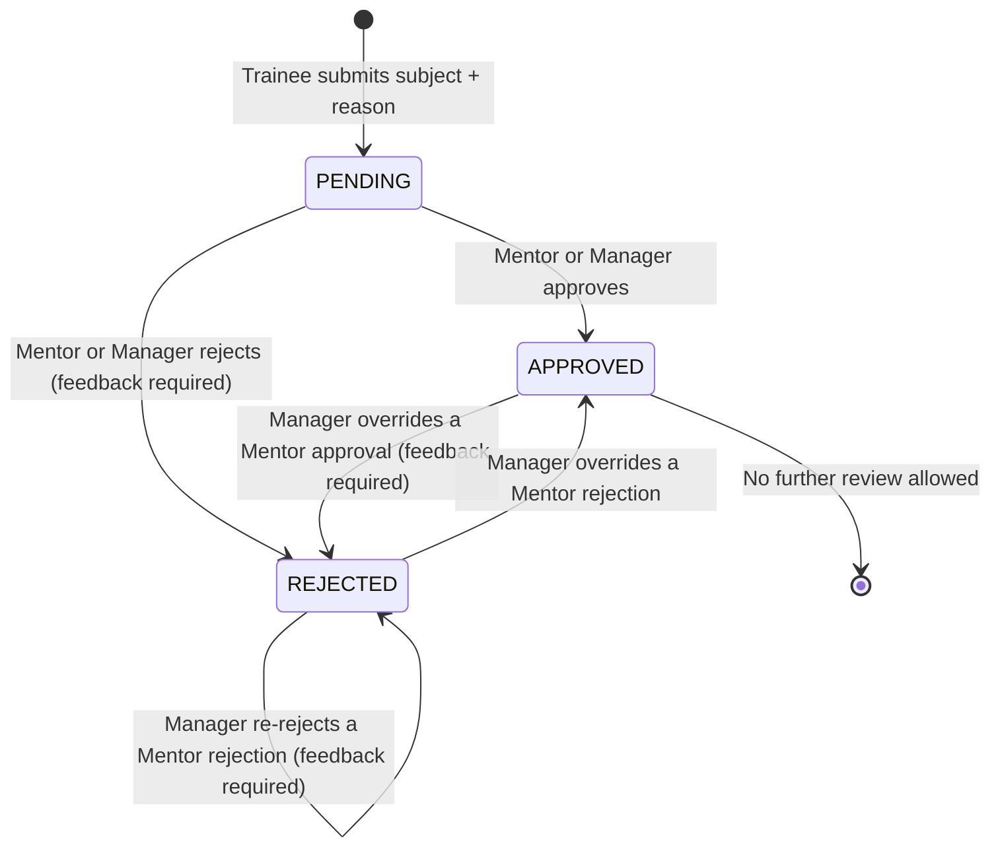

# Leave request workflow (desktop)

Leave requests are submitted by Trainees and reviewed by Mentors and Managers. The workflow uses only
three statuses — `PENDING`, `APPROVED` and `REJECTED` — and never introduces an intermediate state.
A decision is kept as an append-only review record, so a later decision cannot erase an earlier one.

This document preserves the technical detail from the project’s
[leave request workflow](../leave-request-workflow.md) and
[API reference](../api-specifications.md#leave-requests), and adds the desktop app’s routes,
notifications and shared types. The source of truth is `backend/src/module/leave-module/`, the shared
types in `packages/types/src/leave.ts` and the Prisma models in `backend/prisma/schema.prisma`.

## Roles and permissions

| Role    | Submit | Read                                            | Allowed decisions                                                                                                         |
| ------- | ------ | ----------------------------------------------- | ------------------------------------------------------------------------------------------------------------------------- |
| Trainee | Yes    | Only their own requests                         | None — there is no trainee review endpoint                                                                                |
| Mentor  | No     | Only requests for `trainee.mentor_id = user.id` | Approve or reject `PENDING` requests for assigned trainees                                                                |
| Manager | No     | Every request                                   | Approve or reject any `PENDING` request; reject an `APPROVED` request; approve or re-reject a `REJECTED` (Mentor) request |

Mentors cannot review requests for trainees who are not currently assigned to them; an unknown or
out-of-scope id returns `404 NOT_FOUND`. Managers can review any request, including one belonging to
a trainee assigned to a different Mentor. Role checks run in middleware, in the service and in every
database query. Reviewer identity always comes from the authenticated user, never from the request
body.

**Can a Manager override a previous Mentor decision? Yes.** The API permits a Manager to reject a
request approved by a Mentor, and to approve or re-reject a request rejected by a Mentor. The Mentor’s
original `leave_review` row is never replaced: the request’s top-level review fields describe the
**current/final** decision, while `reviews` keeps both decisions. A Mentor cannot change a decided
request, and nobody can change a decision already recorded as their own.

In the desktop renderer, `StaffLeaveRequestsPage` uses an `area` prop (`admin` for Mentors, `manager`
for Managers) to select the API prefix and shows the Manager-only **Assigned Mentor** column.
`canReview` allows a pending request for both roles, but only a Manager can review an already decided
request.

## Lifecycle



1. A Trainee submits a subject (1–200 chars) and reason (1–2,000 chars). The request starts `PENDING`
   with no reviewer, feedback or review timestamp.
2. A Mentor (or a Manager, for example when the Mentor is on leave) reviews a `PENDING` request. An
   approval may include optional feedback; a rejection must include non-blank feedback (max 2,000
   chars). The current status becomes `APPROVED` or `REJECTED`.
3. If a Mentor approved the request, a Manager can still review it and **reject** it. Feedback is
   required. The final status becomes `REJECTED`; the Mentor’s approval stays in the review history.
4. If a Mentor rejected the request, a Manager can review it again and either **approve** it or record
   their own **rejection** (feedback is required to reject). The row snapshot of the current decision
   changes, but both decisions remain in the review history.
5. No other change is allowed: Mentors cannot modify decided requests, and Managers cannot change a
   decision that is already recorded as their own.

| Current status | Reviewer | Decision | Result                         |
| -------------- | -------- | -------- | ------------------------------ |
| `PENDING`      | Mentor   | Approve  | `APPROVED`                     |
| `PENDING`      | Mentor   | Reject   | `REJECTED`                     |
| `PENDING`      | Manager  | Approve  | `APPROVED`                     |
| `PENDING`      | Manager  | Reject   | `REJECTED`                     |
| `APPROVED`     | Mentor   | Any      | `409 ALREADY_REVIEWED`         |
| `APPROVED`     | Manager  | Reject   | `REJECTED` (requires feedback) |
| `APPROVED`     | Manager  | Approve  | `409 ALREADY_REVIEWED`         |
| `REJECTED`     | Mentor   | Any      | `409 ALREADY_REVIEWED`         |
| `REJECTED`     | Manager  | Approve  | `APPROVED`                     |
| `REJECTED`     | Manager  | Reject   | `REJECTED` (requires feedback) |

## Review history and feedback

Two structures are written in the same transaction:

- `leave_request` keeps the request content and a snapshot of the **current/final** decision
  (`status`, `reviewer_id`, `reviewer_role`, `reviewer_name`, `feedback`, `reviewed_at`). Existing API
  clients continue to read these fields.
- `leave_review` is an **append-only** row per decision with the reviewer id, role, name, decision,
  feedback and timestamp. At most one row per role exists for a request
  (`UNIQUE (leave_request_id, reviewer_role)`), so a Manager’s decision cannot overwrite or delete
  the Mentor’s earlier approval or rejection.

Every `LeaveRequest` API response contains `reviews`, an array of `LeaveReview` objects ordered oldest
first. Trainees, Mentors and Managers all see the same complete history: the Trainee page shows it in
each history card, and the shared staff page shows it in the detail dialog. Each entry displays who
reviewed the request, their role, the decision, the timestamp and any feedback. Pending requests have
an empty `reviews` array.

Example of a request approved by a Mentor and then rejected by a Manager (the same applies when a
Manager overrides a Mentor rejection — the Mentor’s `REJECTED` entry stays alongside the Manager’s
`APPROVED`/`REJECTED` entry):

```json
{
  "status": "REJECTED",
  "reviewerId": "manager-id",
  "reviewerRole": "MANAGER",
  "feedback": "The dates changed after approval.",
  "reviews": [
    {
      "id": "review-1",
      "reviewerId": "mentor-id",
      "reviewerName": "Mentor Alice",
      "reviewerRole": "MENTOR",
      "decision": "APPROVED",
      "feedback": "Enjoy the time off.",
      "reviewedAt": "2026-11-21T11:00:00.000Z"
    },
    {
      "id": "review-2",
      "reviewerId": "manager-id",
      "reviewerName": "Manager Bob",
      "reviewerRole": "MANAGER",
      "decision": "REJECTED",
      "feedback": "The dates changed after approval.",
      "reviewedAt": "2026-11-21T12:00:00.000Z"
    }
  ]
}
```

## Integrity and concurrency

The repository performs the scope check, status check, conditional `updateMany` and history insert in
one transaction. A conditional `UPDATE ... WHERE status = 'PENDING'` (or
`status = 'APPROVED' AND reviewer_role = 'MENTOR'` for a Manager rejection, or
`status = 'REJECTED' AND reviewer_role = 'MENTOR'` for a Manager override of a Mentor rejection)
guarantees that only one of two concurrent decisions wins; the loser receives
`409 ALREADY_REVIEWED`. The `UNIQUE (leave_request_id, reviewer_role)` index on `leave_review` is a
second guard against duplicate reviews.

Database constraints still enforce non-blank subjects, reasons and rejection feedback, forbid review
fields while `PENDING`, and require reviewer details once decided. The
`leave_request_status_guard` trigger permits only `PENDING → APPROVED/REJECTED` and
Mentor-decision → Manager-decision transitions (`APPROVED → REJECTED` and
`REJECTED → APPROVED/REJECTED`); all other status or review-field changes are rejected even outside
the API. Foreign keys use `ON DELETE RESTRICT` so removing an account cannot erase request or review
history.

The migration `20261123150000_add_leave_review_history` creates the history table, backfills a review
row for every already-decided request from its existing columns, and replaces the old “decision is
final” trigger. `20261123160000_allow_manager_review_of_mentor_rejection` extends that trigger for the
rejection override; it only replaces the trigger function and touches no data. No records are deleted
by either migration.

## Prisma models

From `backend/prisma/schema.prisma` (see also the [database documentation](../database.md)):

- `leave_request`: `id`, `trainee_id` → `trainee` (`ON DELETE RESTRICT`), `subject`, `reason`,
  `status` (`PENDING | APPROVED | REJECTED`), `reviewer_id` → `admin` (`ON DELETE RESTRICT`),
  `reviewer_role`, `reviewer_name`, `feedback`, `submitted_at`, `reviewed_at`, audit timestamps.
  Indexes: `(trainee_id, submitted_at)` and `(status, submitted_at)`.
- `leave_review`: `id`, `leave_request_id` → `leave_request`, `reviewer_id` → `admin`,
  `reviewer_role`, `reviewer_name`, `decision`, `feedback`, `reviewed_at`, audit timestamp. Unique
  `(leave_request_id, reviewer_role)`; index `(leave_request_id, reviewed_at)`.
- `trainee.mentor_id` → `admin.id` (`ON DELETE SET NULL`) defines the Mentor scope used by every
  `/api/admin/leave-requests` query. Reassignment changes scope immediately.

## Shared TypeScript types

`packages/types/src/leave.ts` is the source of truth:

```ts
type LeaveStatus = 'PENDING' | 'APPROVED' | 'REJECTED';
type LeaveDecision = 'APPROVED' | 'REJECTED';
type LeaveReviewerRole = 'MENTOR' | 'MANAGER';

const LEAVE_SUBJECT_MAX_LENGTH = 200;
const LEAVE_REASON_MAX_LENGTH = 2000;
const LEAVE_FEEDBACK_MAX_LENGTH = 2000;

type LeaveReview = {
  id: string;
  reviewerId: string;
  reviewerName: string;
  reviewerRole: LeaveReviewerRole;
  decision: LeaveDecision;
  feedback: string | null;
  reviewedAt: string;
};

type LeaveRequest = {
  id: string;
  traineeId: string;
  traineeName: string;
  assignedMentor: { id: string; name: string } | null;
  subject: string;
  reason: string;
  status: LeaveStatus;
  submittedAt: string;
  reviewerId: string | null;
  reviewerName: string | null;
  reviewerRole: LeaveReviewerRole | null;
  feedback: string | null;
  reviewedAt: string | null;
  reviews: LeaveReview[];
  createdAt: string;
  updatedAt: string;
};

type CreateLeaveRequestInput = { subject: string; reason: string };
type ReviewLeaveRequestInput = { decision: LeaveDecision; feedback?: string };
type LeaveCountResponse = { count: number };
```

A complete `LeaveRequest` response example is in the
[API reference](../api-specifications.md#leave-requests).

## REST APIs

All endpoints are called by the renderer over the same authenticated `/api` proxy used by the web app.
There is no leave-specific Electron IPC API. The frontend wrappers live in
`frontend/src/api/leave.ts`; backend implementations live in `backend/src/module/leave-module/`.
Errors use the common envelope `{ "error": { "code", "message", "details"? } }`.

### Trainee endpoints

| Field          | `GET /api/leave-requests` | `POST /api/leave-requests`              | `GET /api/leave-requests/:requestId` | `GET /api/leave-requests/unread-count`   |
| -------------- | ------------------------- | --------------------------------------- | ------------------------------------ | ---------------------------------------- |
| Purpose        | Own history, newest first | Submit a new request                    | One own request                      | Count decisions since a client timestamp |
| Authentication | Cookie                    | Cookie                                  | Cookie                               | Cookie                                   |
| Authorization  | Trainee                   | Trainee                                 | Trainee                              | Trainee                                  |
| Parameters     | None                      | None                                    | `requestId` (UUID)                   | Optional `since` query                   |
| Request body   | None                      | `{ "subject": "...", "reason": "..." }` | None                                 | None                                     |
| Response       | `200` `LeaveRequest[]`    | `201` `LeaveRequest`                    | `200` `LeaveRequest`                 | `200` `LeaveCountResponse`               |
| Errors         | `401`, `403`              | `400 VALIDATION_FAILED`, `401`, `403`   | `400`, `401`, `403`, `404 NOT_FOUND` | `401`, `403`                             |

`traineeId` always comes from the JWT. A request belonging to another trainee is returned as
`404 NOT_FOUND`, so ids cannot be guessed to read private leave details. The `since` query is parsed
with `new Date()` and is not schema-validated; an invalid value is not rejected with
`400 VALIDATION_FAILED`.

Frontend methods:

```ts
createLeaveRequest(body: CreateLeaveRequestInput): Promise<LeaveRequest>;
getMyLeaveRequests(): Promise<LeaveRequest[]>;
getMyLeaveRequest(requestId: string): Promise<LeaveRequest>;
getUnreadLeaveCount(since?: string): Promise<LeaveCountResponse>;
```

### Mentor endpoints (assigned trainees only)

| Field          | `GET /api/admin/leave-requests` | `GET /api/admin/leave-requests/:requestId` | `PATCH /api/admin/leave-requests/:requestId/review` | `GET /api/admin/leave-requests/pending-count` |
| -------------- | ------------------------------- | ------------------------------------------ | --------------------------------------------------- | --------------------------------------------- |
| Purpose        | Assigned trainees’ requests     | One assigned request                       | Approve/reject a reviewable request                 | Pending count for assigned trainees           |
| Authentication | Cookie                          | Cookie                                     | Cookie                                              | Cookie                                        |
| Authorization  | Mentor                          | Mentor                                     | Mentor                                              | Mentor                                        |
| Parameters     | None                            | `requestId` (UUID)                         | `requestId` (UUID)                                  | None                                          |
| Request body   | None                            | None                                       | `ReviewLeaveRequestInput`                           | None                                          |
| Response       | `200` `LeaveRequest[]`          | `200` `LeaveRequest`                       | `200` `LeaveRequest`                                | `200` `LeaveCountResponse`                    |
| Errors         | `401`, `403`                    | `400`, `401`, `403`, `404`                 | `400`, `401`, `403`, `404`, `409 ALREADY_REVIEWED`  | `401`, `403`                                  |

### Manager endpoints (all requests)

| Field          | `GET /api/manager/leave-requests` | `GET /api/manager/leave-requests/:requestId` | `PATCH /api/manager/leave-requests/:requestId/review` | `GET /api/manager/leave-requests/pending-count` |
| -------------- | --------------------------------- | -------------------------------------------- | ----------------------------------------------------- | ----------------------------------------------- |
| Purpose        | Every request                     | Any request                                  | Decide or override a request                          | Platform-wide pending count                     |
| Authentication | Cookie                            | Cookie                                       | Cookie                                                | Cookie                                          |
| Authorization  | Manager                           | Manager                                      | Manager                                               | Manager                                         |
| Parameters     | None                              | `requestId` (UUID)                           | `requestId` (UUID)                                    | None                                            |
| Request body   | None                              | None                                         | `ReviewLeaveRequestInput`                             | None                                            |
| Response       | `200` `LeaveRequest[]`            | `200` `LeaveRequest`                         | `200` `LeaveRequest`                                  | `200` `LeaveCountResponse`                      |
| Errors         | `401`, `403`                      | `400`, `401`, `403`, `404`                   | `400`, `401`, `403`, `404`, `409 ALREADY_REVIEWED`    | `401`, `403`                                    |

Review body examples:

```json
{ "decision": "APPROVED", "feedback": "Enjoy the time off." }
```

```json
{ "decision": "REJECTED", "feedback": "Please choose another date." }
```

`feedback` is optional for `APPROVED` (trimmed, max 2,000 chars) and required for `REJECTED` (trimmed,
1–2,000 chars). The reviewer id, role and name come from the authenticated context, never from the
body.

Frontend wrappers use a role prefix:

```ts
type LeaveReviewerArea = 'admin' | 'manager';

getLeaveRequestsForReviewer(area: LeaveReviewerArea): Promise<LeaveRequest[]>;
getLeaveRequestForReviewer(area: LeaveReviewerArea, requestId: string): Promise<LeaveRequest>;
reviewLeaveRequest(
  area: LeaveReviewerArea,
  requestId: string,
  body: ReviewLeaveRequestInput
): Promise<LeaveRequest>;
getPendingLeaveCount(role: 'admin' | 'manager'): Promise<LeaveCountResponse>;
```

## In-app notifications

The renderer keeps two kinds of badge state:

- `GET /api/leave-requests/unread-count?since=<ISO timestamp>` compares decisions with the browser
  key `vinkup.leave.lastSeen`, stored by the Header component. It drives the **Leave requests** badge
  in the trainee header.
- `GET /api/events` (Server-Sent Events, opened by `RealtimeProvider`) pushes scoped events in
  default `message` frames: `leave.submitted`
  (`{ type, traineeId, traineeName, requestId, subject }`) to the trainee’s currently assigned
  Mentor, and `leave.reviewed` (`{ type, traineeId, requestId, decision }`) to the Trainee, the
  reviewer, and the assigned Mentor when that Mentor is not the reviewer. A Manager override re-fires
  `leave.reviewed` because `reviewed_at` moves. Publishing is best effort; REST remains the source of
  truth.
- Staff pending counts (`GET /api/admin/leave-requests/pending-count` and
  `GET /api/manager/leave-requests/pending-count`) back the staff leave page’s pending view.

The shared `LeaveReviewHistory` component renders the same `reviews` array for Trainees, Mentors and
Managers.

## Slack notifications

Creating a leave request may also enqueue a Slack message for the trainee’s currently assigned
Mentor. That notification contains **only the trainee’s name and the leave subject** — never the
description/reason, dates, duration, feedback, status or any other private detail. Approvals and
rejections never queue Slack messages. See [slack.md](./slack.md#leave-requests) for the outbox,
worker and security rules.

## Tests and source map

Backend tests live in `backend/src/module/leave-module/` and
`backend/src/test/api/leave-request.api.test.ts`; they cover submission and validation, trainee
isolation, Mentor assignment scoping, Manager platform-wide access, recorded reviewer identity,
rejection validation, Manager overrides of both Mentor decisions, and concurrent decisions. Frontend
tests cover `LeaveRequestsPage` and `StaffLeaveRequestsPage`. Run them with:

```bash
npm test
npm run test:api -w backend   # needs TEST_DATABASE_URL
```

| Area             | Files                                                                                          |
| ---------------- | ---------------------------------------------------------------------------------------------- |
| Backend module   | `backend/src/module/leave-module/`                                                             |
| Shared types     | `packages/types/src/leave.ts`                                                                  |
| Trainee UI       | `frontend/src/pages/LeaveRequestsPage/`                                                        |
| Staff UI         | `frontend/src/pages/StaffLeaveRequestsPage/` and `frontend/src/components/LeaveReviewHistory/` |
| API wrapper      | `frontend/src/api/leave.ts`                                                                    |
| Database         | `backend/prisma/schema.prisma`, `docs/database.md`                                             |
| Original guide   | [leave-request-workflow.md](../leave-request-workflow.md)                                      |
| Roles and guards | [roles-and-assignments.md](../roles-and-assignments.md#7-leave-request-workflow)               |
