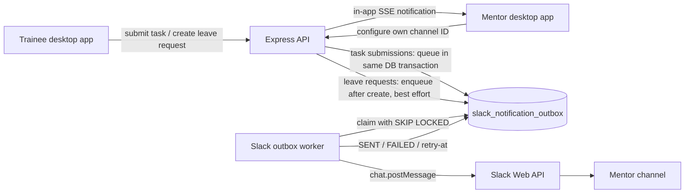

# Slack integration (desktop)

Vinkup can send task submission and leave request notifications to a Slack channel configured by each
mentor. One shared Slack bot is used by the whole application; mentors do not create bots or enter
tokens. The Electron desktop app reaches this feature through the same authenticated REST API as the
web app: **there is no dedicated `window.desktop.slack` API**.

This document reuses the project’s [Slack integration guide](../slack-integration.md) and adds the
desktop-specific UI and API details. The backend sources are
`backend/src/lib/slack.ts`, `backend/src/module/slack-module/` and the `slack_notification_outbox`
model in `backend/prisma/schema.prisma`.

## Architecture



1. A mentor saves a Slack **channel ID** in the **Integrations** tab of the mentor dashboard
   (`/admin`), rendered by `frontend/src/pages/AdminTraineesPage/SlackIntegrationSection.tsx`.
2. When a trainee submits or resubmits a task, or creates a leave request, the backend resolves the
   trainee’s assigned mentor at that time.
3. If that mentor has a channel configured and `SLACK_ENABLED=true`, a notification record is written
   to the `slack_notification_outbox` table. Task submissions are queued in the same database
   transaction as the submission. **No Slack API call is made from the HTTP request**, so a slow or
   unavailable Slack service never delays the trainee.
4. A background worker claims pending records, posts the message with `chat.postMessage`, and records
   `SENT`, `FAILED`, or a future retry time.

Leave notifications are queued only after a new leave request is successfully created. Approving or
rejecting a leave request never queues a Slack notification. If Slack is disabled, the trainee has no
mentor, the mentor has no channel, or queueing fails, the leave request is still created and the rest
of the workflow continues normally with no Slack notification. Existing in-app/SSE notifications and
mentor/manager review permissions are unchanged.

For task submissions, a duplicate outbox write (`P2002`) is ignored, but any other outbox error is
rethrown inside the submission transaction and fails the submission. Leave queue failures are logged
and swallowed; the leave request remains.

## Slack application setup

1. In [api.slack.com/apps](https://api.slack.com/apps), choose **Create New App → From scratch**.
2. Open **OAuth & Permissions → Bot Token Scopes** and add **`chat:write`**.
3. Open **OAuth & Permissions → Install App to Workspace** and install the app.
4. Copy the **Bot User OAuth Token** (`xoxb-...`) into `backend/.env` as `SLACK_BOT_TOKEN`.
5. Invite the bot to every mentor channel that should receive notifications:
   in the Slack channel, type `/invite @<your-bot-name>`.

No `SLACK_APP_TOKEN`, Socket Mode, event subscriptions or message listeners are required. This is an
outgoing-message-only integration.

To find a channel ID, open the channel in Slack, click the channel name, then **View channel
details**. The Channel ID is shown near the bottom (for example `C0123ABCDEF`). Vinkup expects a
public or private channel, not a direct message.

## Environment configuration and token security

Add these to `backend/.env` (see `backend/.env.example`):

```env
SLACK_ENABLED=false
SLACK_BOT_TOKEN=
```

- `SLACK_ENABLED` defaults to `false`. Accepted true values are `true` and `1`; false values are
  `false`, `0` and blank.
- When enabled, `SLACK_BOT_TOKEN` must contain the shared bot token; startup fails with a clear
  validation error otherwise.
- When disabled, no Slack credentials are needed and the worker does not start.
- **The bot token is never returned by any API and is never sent to the frontend or Electron
  renderer.** Only the backend process and its Slack client read it. The desktop app stores only the
  channel ID the mentor configures; it never stores a bot token.

## Mentor channel configuration in the desktop app

Sign in as a mentor and open the mentor dashboard (`/admin`), then select the **Integrations** tab.

- **Add:** paste the Channel ID and choose **Save Channel**.
- **View:** the configured ID is shown with a **Connected** badge.
- **Update:** choose **Edit**, replace the ID, then choose **Save Channel**. **Cancel** restores the
  old value.
- **Delete:** choose **Disconnect**, then confirm in the dialog. Notifications stop for future
  submissions and leave requests; already queued notifications keep their original destination.

The UI upper-cases the ID and checks that it is non-empty, at most 32 characters and matches
`/^[A-Z0-9]+$/`. The backend trims the value but **does not upper-case it**, so a lowercase ID sent
directly to the API fails validation. The mentor id always comes from the authenticated session
(`req.user.id`), never from the request body. A mentor cannot view or change another mentor’s channel,
and trainees/managers cannot access these endpoints.

### Frontend API methods

Defined in `frontend/src/api/admin.ts` and called from `SlackIntegrationSection.tsx`:

| Method                                  | REST call                         |
| --------------------------------------- | --------------------------------- |
| `getMentorSlackChannel()`               | `GET /api/admin/slack-channel`    |
| `saveMentorSlackChannel({ channelId })` | `PUT /api/admin/slack-channel`    |
| `deleteMentorSlackChannel()`            | `DELETE /api/admin/slack-channel` |

All calls use the shared Axios client (`baseURL: '/api'`, `withCredentials: true`) and therefore carry
the renderer’s desktop `auth_token` cookie. The Electron main process proxies `/api` to the backend;
it does not expose a separate Slack IPC channel.

### Backend REST endpoints

| Field          | `GET /api/admin/slack-channel`                          | `PUT /api/admin/slack-channel`                 | `DELETE /api/admin/slack-channel`    |
| -------------- | ------------------------------------------------------- | ---------------------------------------------- | ------------------------------------ |
| Purpose        | Read the signed-in mentor’s channel                     | Save or replace the signed-in mentor’s channel | Clear the signed-in mentor’s channel |
| Authentication | Authenticated (cookie)                                  | Authenticated (cookie)                         | Authenticated (cookie)               |
| Authorization  | Mentor only                                             | Mentor only                                    | Mentor only                          |
| Parameters     | None                                                    | None                                           | None                                 |
| Request body   | None                                                    | `{ "channelId": "C0123ABCDEF" }`               | None                                 |
| Response       | `200` `{ "channelId": "C0123ABCDEF" }` or `null`        | `200` `{ "channelId": "C0123ABCDEF" }`         | `200` `{ "channelId": null }`        |
| Errors         | `401`, `403`, `404 NOT_FOUND` if the mentor row is gone | `400 VALIDATION_FAILED`, `401`, `403`          | `401`, `403`                         |

Shared types are `MentorSlackChannelResponse` and `SaveMentorSlackChannelRequest` in
`packages/types/src/admin.ts`:

```ts
type MentorSlackChannelResponse = { channelId: string | null };
type SaveMentorSlackChannelRequest = { channelId: string };
```

Deleting when unset is a no-op. Saving the same ID is allowed. Channel IDs are stored on the mentor’s
`admin` row, not as a frontend setting, so the choice follows the mentor across devices.

## Notification outbox

The outbox row stores the channel ID resolved when the task was submitted or the leave request was
created. Changing or deleting the mentor’s configuration later affects only future notifications.
Each row also has a dedupe key: `task_submission:<trainee>:<task>:<submission>` for task submissions
and `leave_request:<request-id>` for leave requests, so the same event cannot be queued twice.

- **Statuses:** `PENDING`, `PROCESSING`, `SENT`, `FAILED`.
- **Claiming:** the worker uses `FOR UPDATE SKIP LOCKED` so multiple workers cannot process the same
  row concurrently. Claimed rows get a processing lease.
- **Success:** `SENT`, with `sent_at`.
- **Temporary failures** (network, 5xx, HTTP 429/`ratelimited`): retried with exponential backoff
  (15 s base, capped at 5 min, plus up to 999 ms of jitter). A numeric-seconds `Retry-After` header is
  honoured by waiting `max(retryAfterSeconds * 1000, 15_000)`; that value is not capped at 5 min.
- **Permanent failures** are `invalid_auth`, `account_inactive`, `token_revoked`, `token_expired`,
  `missing_scope`, `channel_not_found`, `is_archived`, `invalid_channel` and
  `parameter_validation_failed`. They are marked `FAILED` and kept for inspection.
- **Other failures** — any Slack error not in the permanent list, plus generic errors — are retried
  until `max_attempts` (default 5), then marked `FAILED`.
- **Lease recovery:** worker startup returns expired `PROCESSING` leases to `PENDING`; every 5-second
  poll also claims `PROCESSING` rows older than 60 seconds, renewing the lease and incrementing the
  attempt count.
- **Worker lifecycle:** the worker starts when the backend listens and stops gracefully on
  `SIGINT`/`SIGTERM`.

## Message contents

### Task submissions

Task submission messages include trainee name, task title, course title, day number (when
available), submission count, submission timestamp and review status.

### Leave requests

> **Privacy rule:** a leave notification contains **only the trainee’s name and the leave subject**.
> It never includes the description/reason, start or end dates, duration, notes, review feedback,
> status, or any other private leave detail. No approval/rejection buttons or other interactive Slack
> actions are sent.

```text
:calendar: *Leave Request*

*John Doe* has requested a leave.

*Subject:* Personal Leave
```

Escaping for `&`, `<` and `>` (plus zero-width insertion into `@here`, `@channel` and `@everyone`)
applies to leave message text and the Task Block Kit fields. Arbitrary `@username` mentions are not
neutralized, and internal IDs and tokens are not included. The task fallback `text` uses the raw
trainee name and task title, so it is not mention-safe; see [known limitations](#known-limitations).

In-app notifications are a separate channel. Trainee header badges use
`GET /api/leave-requests/unread-count?since=…`; mentor/manager badges use `getPendingLeaveCount(role)`
— `GET /api/admin/leave-requests/pending-count` for mentors and
`GET /api/manager/leave-requests/pending-count` for managers. `GET /api/events` refreshes the counts
over SSE. Disabling Slack or failing delivery does not suppress those in-app notifications.

## Source files

| Area                      | Files                                                                                                                                               |
| ------------------------- | --------------------------------------------------------------------------------------------------------------------------------------------------- |
| Shared bot / message text | `backend/src/lib/slack.ts`                                                                                                                          |
| Outbox persistence        | `backend/src/module/slack-module/slack-notification.repository.ts`                                                                                  |
| Worker                    | `backend/src/module/slack-module/slack-notification.worker.ts`                                                                                      |
| Channel API               | `backend/src/module/admin-module/admin.{routes,controller,service,repository,schema}.ts` and `backend/src/test/api/admin-slack-channel.api.test.ts` |
| Desktop UI                | `frontend/src/pages/AdminTraineesPage/SlackIntegrationSection.tsx` and `frontend/src/api/admin.ts`                                                  |
| Types                     | `packages/types/src/admin.ts`                                                                                                                       |

## Known limitations

- Live delivery depends on a real Slack workspace, a valid token with `chat:write`, and the bot being
  invited to each channel. Automated tests mock all Slack API calls.
- The worker polls every 5 seconds; notifications are near-real-time, not instant.
- Failed rows are retained for investigation; there is no admin UI to replay them yet.
- The task fallback `text` in `backend/src/module/slack-module/slack-notification.worker.ts` uses the
  raw trainee name and task title; only the Block Kit fields and leave messages are escaped.
- A plain browser build can configure and use the same REST endpoints, but the desktop app offers no
  additional Slack-specific Electron API.
