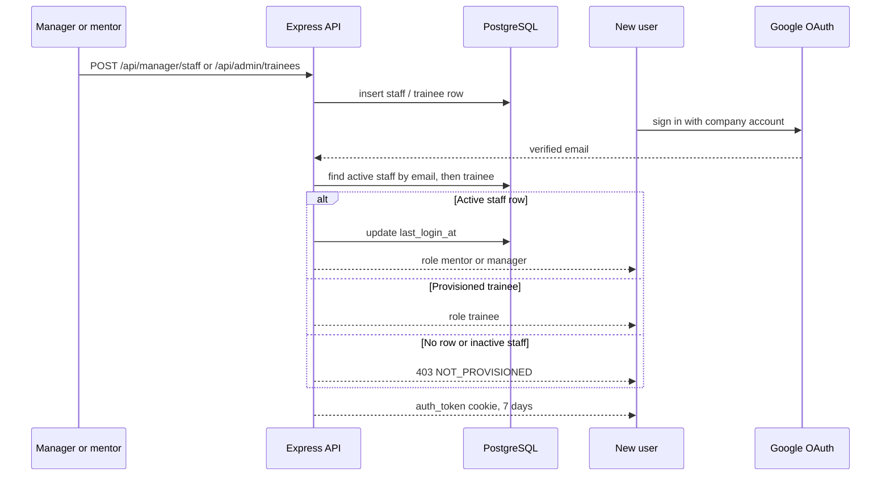
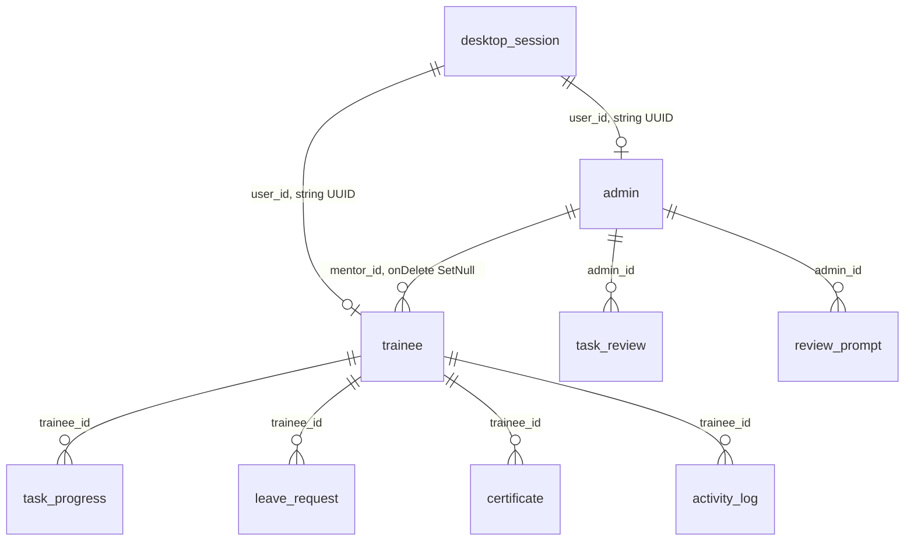

# Users, roles and assignments

Vinkup has three account roles — **trainee**, **mentor** and **manager**. The React app and the Electron
desktop app use the same backend, so both use the same REST endpoints and authorization rules. The
renderer never decides who may see a record; the API does.

This document describes the implementation in `backend/src/middleware/authMiddleware.ts`,
`backend/src/module/auth-module/`, `backend/src/module/admin-module/`,
`backend/src/module/manager-module/`, `backend/src/module/profile-module/` and
`backend/prisma/schema.prisma`. It reuses the project’s longer
[roles and assignments guide](../roles-and-assignments.md) for background. For the desktop sign-in
flow and the `window.desktop.auth` API, see [authentication](auth.md).

## Role model

| Role    | Prisma record                 | Frontend area      | REST area                                                                             | Scope                                                       |
| ------- | ----------------------------- | ------------------ | ------------------------------------------------------------------------------------- | ----------------------------------------------------------- |
| trainee | `trainee`                     | `/`, trainee pages | `/api/profile`, `/api/dashboard`, `/api/tasks`, `/api/days`, `/api/leave-requests`, … | Own data only                                               |
| mentor  | `admin` with `role = MENTOR`  | `/admin`           | `/api/admin`                                                                          | Trainees whose `trainee.mentor_id` equals the mentor’s `id` |
| manager | `admin` with `role = MANAGER` | `/manager`         | `/api/manager`                                                                        | All staff and trainees                                      |

Important naming detail: the table and routes are still called `admin` for compatibility, but
`requireAdmin` is an alias of `requireMentor` in
`backend/src/middleware/authMiddleware.ts`. **`/api/admin` is mentor-only.** Managers use `/api/manager`.
The shared `UserRole` union is `'trainee' | 'mentor' | 'manager'`; the database enum `staff_role` is
`MENTOR | MANAGER`.

## Authorization guards

`requireAuth` reads the `auth_token` JWT cookie, verifies it and sets `request.user`. Role guards run
`requireAuth` first, check the JWT role, and then re-read the database on **every request** to confirm
the account is still active and has the expected role. A deactivated account therefore loses access
immediately, without waiting for token expiry.

| Guard                    | Rule                                                                                                  |
| ------------------------ | ----------------------------------------------------------------------------------------------------- |
| `requireAuth`            | Valid JWT cookie; no role restriction                                                                 |
| `requireTrainee`         | Role `trainee` plus an active `trainee` row; mentors and managers receive `403 FORBIDDEN`             |
| `requireMentor`          | Role `mentor` plus an active `admin` row with `role = MENTOR`                                         |
| `requireAdmin`           | Alias of `requireMentor`                                                                              |
| `requireManager`         | Role `manager` plus an active `admin` row with `role = MANAGER`                                       |
| `requireStaff`           | Active `MENTOR` or `MANAGER`                                                                          |
| `requireAssignedTrainee` | After `requireMentor`: the target trainee exists and `trainee.mentor_id` is the signed-in mentor’s ID |

`requireAssignedTrainee` re-checks the assignment on each request, so a manager’s reassignment takes
effect at once. Unassigned trainees are invisible to mentors until a manager assigns them.

Every API error uses `ApiErrorResponse` from `packages/types/src/common.ts`:

```ts
type ApiErrorResponse = {
  error: {
    code: ErrorCode;
    message: string;
    details?: unknown;
  };
};
```

Common codes for this area are `UNAUTHENTICATED` (401), `FORBIDDEN` (403), `NOT_FOUND` (404),
`VALIDATION_FAILED` (400), `DOMAIN_NOT_PERMITTED`, `NOT_PROVISIONED`, `TRAINEE_EXISTS`, `STAFF_EXISTS`,
`STAFF_HAS_TRAINEES`, `EMAIL_BELONGS_TO_ADMIN`, `ALREADY_ASSIGNED` and `INVALID_MENTOR`.

## Account creation and sign-in

Accounts are provisioned before anyone can sign in. Google OAuth only proves the company email; the
backend decides the role and the data scope.



- The Google email must end in `@${ALLOWED_EMAIL_DOMAIN}`; otherwise sign-in fails with
  `DOMAIN_NOT_PERMITTED`.
- An active `admin` row wins over a trainee row with the same email. Its `staff_role` maps to the
  `MENTOR` or `MANAGER` JWT role.
- A trainee must already exist in the `trainee` table; otherwise sign-in fails with `NOT_PROVISIONED`.
- The web flow sets the cookie in `/api/auth/google/callback`. The Electron flow exchanges a one-time
  handoff code and stores refresh tokens in the main process; see [authentication](auth.md).
- `GET /api/auth/me` (any authenticated role) returns the current `MeResponse`:

```ts
type UserRole = 'trainee' | 'mentor' | 'manager';
type MeResponse = { id: string; email: string; name: string; role: UserRole };
```

- `GET /api/profile` is trainee-only and returns `ProfileData`. Mentors read the same profile through
  `GET /api/admin/trainees/:traineeId`; they cannot use the trainee route.

## Trainee APIs available to the desktop app

| Method | Endpoint                             | Response             | Notes                        |
| ------ | ------------------------------------ | -------------------- | ---------------------------- |
| GET    | `/api/auth/me`                       | `MeResponse`         | Any authenticated role       |
| GET    | `/api/profile`                       | `ProfileData`        | Own profile, trainee only    |
| GET    | `/api/dashboard`                     | `DashboardResponse`  | Own progress and time totals |
| GET    | `/api/courses/:courseId/days`        | `CourseDaysResponse` | Day summaries for one course |
| GET    | `/api/courses/:courseId/certificate` | `CourseCertificate`  | Own certificate record       |

Course, day, task, review and leave endpoints are covered in
[course workflow](course_workflow.md), [leave requests](leave_request.md) and the
[API reference](../api-specifications.md).

## Mentor APIs (`/api/admin`)

These routes are behind `requireAdmin` (`requireMentor`). The mentor-scoped detail endpoints also use
`requireAssignedTrainee`.

| Method | Endpoint                                            | Request                         | Response                     |
| ------ | --------------------------------------------------- | ------------------------------- | ---------------------------- |
| GET    | `/api/admin/trainees`                               | —                               | `AdminTraineeSummary[]`      |
| POST   | `/api/admin/trainees`                               | `CreateTraineeRequest`          | `AdminTraineeSummary` (201)  |
| GET    | `/api/admin/trainees/:traineeId`                    | UUID param                      | `AdminTraineeDetail`         |
| GET    | `/api/admin/trainees/:traineeId/flags`              | UUID param                      | `AdminFlagEvent[]`           |
| GET    | `/api/admin/trainees/:traineeId/tasks/:taskId/code` | UUID + task slug                | `AdminTaskCode`              |
| GET    | `/api/admin/trainees/:traineeId/feedback`           | UUID param                      | `AdminFeedbackEntry[]`       |
| GET    | `/api/admin/analytics`                              | `AdminAnalyticsQuery`           | `AdminAnalytics`             |
| GET    | `/api/admin/slack-channel`                          | —                               | `MentorSlackChannelResponse` |
| PUT    | `/api/admin/slack-channel`                          | `SaveMentorSlackChannelRequest` | `MentorSlackChannelResponse` |
| DELETE | `/api/admin/slack-channel`                          | —                               | `MentorSlackChannelResponse` |

Shared request and response types (from `packages/types/src/admin.ts`):

```ts
type CreateTraineeRequest = { name: string; email: string };

type AdminTraineeSummary = {
  id: string;
  name: string;
  email: string;
  daysCompleted: number;
  totalDays: number;
  currentDay: {
    id: string;
    courseTitle: string;
    dayNumber: number;
    title: string;
  } | null;
  todayActiveSeconds: number;
  totalActiveSeconds: number;
  totalCodingSeconds: number;
  lastActiveDate: string | null;
  latestWpm: number | null;
  flagsLast7Days: number;
  averageScore: number | null;
  daysScored: number;
  pendingReviewItems: {
    taskId: string;
    taskTitle: string;
    dayId: string;
    courseTitle: string;
    dayNumber: number;
    lastSubmittedAt: string | null;
  }[];
};

type AdminTraineeDetail = {
  id: string;
  profile: ProfileData;
  typingStats: TypingStats;
  courses: { id: string; title: string; days: AdminDay[] }[];
  tasks: AdminTaskRow[];
  totalTasks: number;
  journal: AdminJournalEntry[];
};

type AdminAnalyticsQuery = {
  from: string; // YYYY-MM-DD
  to: string; // YYYY-MM-DD
  traineeId?: string;
};

type MentorSlackChannelResponse = { channelId: string | null };
type SaveMentorSlackChannelRequest = { channelId: string };
```

Rules implemented by `AdminService`:

- `GET /api/admin/trainees` lists only trainees assigned to the signed-in mentor.
- `POST /api/admin/trainees` validates a trimmed 2–80 character name and a lower-cased company email,
  rejects duplicates, and assigns the new trainee to that mentor immediately.
- `GET /api/admin/analytics` accepts `from`/`to` as `YYYY-MM-DD`, `from <= to`, `to` not in the future
  (Asia/Kolkata calendar date) and a maximum span of 366 inclusive days. Omitting `traineeId` covers the
  mentor’s whole team; specifying it still uses `requireAssignedTrainee`.
- `AdminFlagEvent` records are mentor-only; the corresponding raw flags are never served to trainees.
- Slack channel configuration is per mentor. The API stores and returns a channel **ID**, not a bot
  token; see [Slack](slack.md).

Task approval/rework endpoints also live under `/api/admin`; they are documented in
[course workflow](course_workflow.md).

## Manager APIs (`/api/manager`)

These routes are behind `requireManager` and cover all staff and trainees.

| Method | Endpoint                                  | Request                       | Response                   |
| ------ | ----------------------------------------- | ----------------------------- | -------------------------- |
| GET    | `/api/manager/staff`                      | —                             | `ManagerStaffMember[]`     |
| POST   | `/api/manager/staff`                      | `CreateManagerStaffRequest`   | `ManagerStaffMember` (201) |
| PATCH  | `/api/manager/staff/:staffId`             | `UpdateManagerStaffRequest`   | `ManagerStaffMember`       |
| PATCH  | `/api/manager/staff/:staffId/status`      | `SetAccountActiveRequest`     | `ManagerStaffMember`       |
| GET    | `/api/manager/trainees`                   | —                             | `ManagerTrainee[]`         |
| POST   | `/api/manager/trainees`                   | `CreateManagerTraineeRequest` | `ManagerTrainee` (201)     |
| PATCH  | `/api/manager/trainees/:traineeId`        | `UpdateManagerTraineeRequest` | `ManagerTrainee`           |
| PATCH  | `/api/manager/trainees/:traineeId/status` | `SetAccountActiveRequest`     | `ManagerTrainee`           |
| PATCH  | `/api/manager/trainees/:traineeId/mentor` | `AssignMentorRequest`         | `ManagerTrainee`           |

Shared request and response types (from `packages/types/src/manager.ts`):

```ts
type ManagerStaffRole = Extract<UserRole, 'mentor' | 'manager'>;

type ManagerStaffMember = {
  id: string;
  name: string;
  email: string;
  role: ManagerStaffRole;
  isActive: boolean;
  assignedTraineeCount: number;
  createdAt: string;
  lastLoginAt: string | null;
};

type ManagerTrainee = {
  id: string;
  name: string;
  email: string;
  isActive: boolean;
  mentor: { id: string; name: string; email: string } | null;
};

type CreateManagerStaffRequest = { name: string; email: string; role: ManagerStaffRole };
type UpdateManagerStaffRequest = { name?: string; email?: string; role?: ManagerStaffRole };
type CreateManagerTraineeRequest = { name: string; email: string; mentorId?: string | null };
type UpdateManagerTraineeRequest = { name?: string; email?: string };
type AssignMentorRequest = { mentorId: string | null }; // null unassigns
type SetAccountActiveRequest = { isActive: boolean };
```

Validation and business rules from `manager.schema.ts` and `manager.service.ts`:

- Names are trimmed, collapsed to single spaces, 2–80 characters. Emails are trimmed, lower-cased,
  valid and at most 254 characters. Every created or changed email must end in the allowed company
  domain.
- Update bodies must contain at least one field.
- A manager cannot deactivate their own account or change their own role to mentor.
- Promoting a mentor to manager, or deactivating a mentor, is rejected with `STAFF_HAS_TRAINEES` while
  they still have assigned trainees. Reassign or unassign them first.
- A mentor passed to create/assign must be an active `MENTOR`; an invalid target returns
  `INVALID_MENTOR` (400). Assigning the same mentor twice returns `ALREADY_ASSIGNED` (409).
- Reassigning emits a silent `trainee.reassigned` real-time event to the previous and new mentor.
  Each mentor’s list re-reads REST data; no toast is sent.
- Duplicate staff/trainee emails and cross-type collisions return `TRAINEE_EXISTS`, `STAFF_EXISTS` or
  `EMAIL_BELONGS_TO_ADMIN` (409).

## Frontend and desktop routes

`frontend/src/App.tsx` places trainee pages behind `RoleRoute role="trainee"`, mentor pages behind
`RoleRoute role="mentor"` and manager pages behind `RoleRoute role="manager"`. These are UI guards
only; the server guards above are the security boundary.

| Route                         | Role    | Page                                              |
| ----------------------------- | ------- | ------------------------------------------------- |
| `/profile`                    | trainee | Profile                                           |
| `/admin`                      | mentor  | Assigned trainee list, cohort summary, CSV export |
| `/admin/trainees/:traineeId`  | mentor  | Assigned trainee detail and printable report      |
| `/admin/leave-requests`       | mentor  | Leave requests from assigned trainees             |
| `/admin/verify-certificate`   | mentor  | Certificate verification                          |
| `/manager`                    | manager | Staff and trainee administration                  |
| `/manager/leave-requests`     | manager | All leave requests                                |
| `/manager/verify-certificate` | manager | Certificate verification                          |

In Electron, `window.desktop.auth.getState()` supplies the renderer with
`DesktopAuthState.status`, `DesktopAuthState.user: MeResponse | null` and a `persistent` flag. Tokens
remain in the main process, so user-management pages still call the REST API with `withCredentials`
through the `/api` proxy; see [authentication](auth.md) and
[workspace](workspace.md).

## Prisma relationships



- `admin.id` is a UUID primary key; `admin.email` is unique and stored lower-case.
- `trainee.id` is a UUID primary key; `trainee.email` is unique. `trainee.mentor_id` is a nullable
  UUID foreign key to `admin.id` with `onDelete: SetNull`; it is the single source of truth for
  mentor scope.
- `admin.role` defaults to `MENTOR`; `admin.is_active` and `trainee.is_active` default to `true`, and
  `false` prevents sign-in.
- `desktop_session` stores only a SHA-256 hash of the desktop refresh token plus a snapshot of
  `user_id`, `user_role`, `user_email` and `user_name`. It has no Prisma relation to `admin` or
  `trainee`; `user_id` is a plain UUID string. A database read cannot be replayed as a session.
- `task_progress` is unique on `(trainee_id, task_id)`; `task_review` is unique on
  `(trainee_id, task_id, submission_no)`; `certificate` is unique on `(trainee_id, course_id)`.

## Known limitation

The desktop renderer is not a separate trust boundary for staff screens: role-based rendering hides
navigation, but the API guards listed above are what enforce access. Do not add a privileged action
that relies only on `RoleRoute` or on a window flag.
