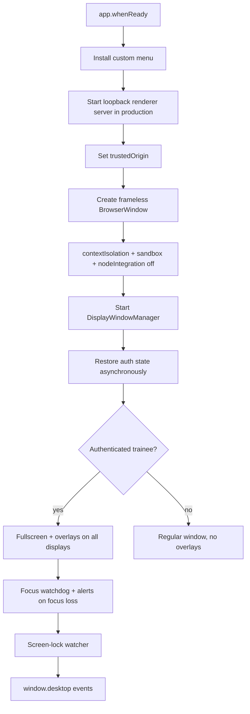

# Window and display management

The main Electron process owns the application window, fullscreen state, secondary-display overlays,
focus alerts, screen-lock notifications and native PDF dialogs. The renderer receives a small,
context-isolated API through `window.desktop`; a secondary display window receives a different,
smaller API through `window.vinkupDisplay`.

The authoritative type is `DesktopApi.window` in `packages/types/src/desktop.ts`, exposed by
`desktop/src/preload/index.ts`. The implementation is `desktop/src/main/index.ts` and
`desktop/src/main/displayWindowManager.ts`. Configuration lives in `desktop/src/main/config.ts`,
`desktop/src/main/screenProtectionConfig.ts` and `desktop/src/main/screenLockWatcher.ts`. See
[authentication](auth.md) for the auth-state broadcast that drives protection and
[resources](workspace.md) for the local runtime that shares the renderer window.

## Window API signatures

```ts
type BrowserAvailability = {
  mainResourcesActive: boolean;
  secondaryResourcesActive: boolean;
};

interface DesktopApi {
  app: {
    getInfo: () => Promise<DesktopAppInfo>;
  };
  window: {
    setFullscreen: (value: boolean) => Promise<boolean>;
    isFullscreen: () => Promise<boolean>;
    setDisplayTheme: (theme: 'light' | 'dark') => Promise<void>;
    isAllowedOverlayContentFocused: () => Promise<boolean>;
    onAllowedOverlayContentFocusChange: (listener: (isFocused: boolean) => void) => () => void;
    getBrowserAvailability: () => Promise<BrowserAvailability>;
    onBrowserAvailabilityChange: (
      listener: (availability: BrowserAvailability) => void
    ) => () => void;
    onFullscreenChange: (listener: (isFullscreen: boolean) => void) => () => void;
    onOwnWindowActivity?: (listener: () => void) => () => void;
    onScreenLockChange?: (listener: (locked: boolean) => void) => () => void;
  };
  certificate: {
    savePdf: (fileName: string) => Promise<{ fileName: string; location: string }>;
  };
  report: {
    savePdf: (fileName: string) => Promise<boolean>;
  };
}

type DesktopAppInfo = {
  version: string;
  platform: 'linux' | 'darwin' | 'win32';
  isPackaged: boolean;
};
```

All listener methods return an unsubscribe function. `onOwnWindowActivity` and `onScreenLockChange`
are declared optional in the shared type but are implemented by the preload bridge.

### Method behavior

| Method                                    | Behavior                                                                                                               |
| ----------------------------------------- | ---------------------------------------------------------------------------------------------------------------------- |
| `app.getInfo()`                           | Returns `Electron app.getVersion()`, `process.platform` and `app.isPackaged`.                                          |
| `window.setFullscreen(value)`             | Calls `setFullScreen(Boolean(value))` on the sender’s `BrowserWindow` and resolves with its actual `isFullScreen()`.   |
| `window.isFullscreen()`                   | Resolves with the sender window’s current fullscreen state, or `false` when no window exists.                          |
| `window.setDisplayTheme(theme)`           | Accepts exactly `'light'` or `'dark'` and applies the theme to every live secondary overlay.                           |
| `window.isAllowedOverlayContentFocused()` | Resolves `true` only when the focused secondary overlay has References or Resources active.                            |
| `window.getBrowserAvailability()`         | Resolves `{ mainResourcesActive, secondaryResourcesActive }` from the display manager.                                 |
| `certificate.savePdf(fileName)`           | Prints the certificate page to PDF and saves it into an available location. Resolves with the final name and location. |
| `report.savePdf(fileName)`                | Opens a native Save dialog, prints the current page as A4 portrait and resolves `true` unless the trainee cancels.     |

`certificate.savePdf` is rejected unless the requesting frame URL has the shape
`/certificates/<id>`; `report.savePdf` accepts any trusted sender. Both sanitize the suggested file
name (basename, control/path characters replaced, `.pdf` suffix removed) and use a fallback name when
nothing usable remains. Certificates use A4 landscape with `preferCSSPageSize` and try Downloads,
then `Documents/VinkUp Certificates`, then `<userData>/Certificates`. Reports use A4 portrait and an
explicit native save path.

## IPC channels

| Channel                                        | Kind             | Payload / result                                                     |
| ---------------------------------------------- | ---------------- | -------------------------------------------------------------------- |
| `app:get-info`                                 | invoke           | → `DesktopAppInfo`                                                   |
| `window:set-fullscreen`                        | invoke           | `boolean` → actual fullscreen `boolean`                              |
| `window:is-fullscreen`                         | invoke           | → `boolean`                                                          |
| `window:set-display-theme`                     | invoke           | `'light' \| 'dark'` → `void` (main window + main frame required)     |
| `window:is-allowed-overlay-content-focused`    | invoke           | → `boolean` (main window + main frame required)                      |
| `browser:get-availability`                     | invoke           | → `BrowserAvailability`                                              |
| `auth:state-changed`                           | main → renderer  | `DesktopAuthState`                                                   |
| `window:allowed-overlay-content-focus-changed` | main → renderer  | `boolean`                                                            |
| `window:fullscreen-changed`                    | main → renderer  | `boolean`                                                            |
| `window:own-window-activity`                   | main → renderer  | no payload                                                           |
| `power:screen-lock-changed`                    | main → renderer  | `boolean` (locked)                                                   |
| `browser:availability-changed`                 | main → renderer  | `BrowserAvailability`                                                |
| `certificate:save-pdf`                         | invoke           | file name → `{ fileName, location }` (certificate page + main frame) |
| `report:save-pdf`                              | invoke           | file name → `boolean`                                                |
| `display-alert:choice`                         | renderer → main  | `'back' \| 'exit'` from an owned alert window                        |
| `display-overlay:references-active`            | renderer → main  | `boolean` from an owned overlay                                      |
| `display-overlay:resources-active`             | renderer → main  | `boolean` from an owned overlay main frame                           |
| `display-overlay:auth-state`                   | main → secondary | `(authenticated: boolean, animate: boolean)`                         |
| `resources:activity`                           | renderer → main  | activity from overlay chrome                                         |

`window:fullscreen-changed` is emitted from Electron’s `enter-full-screen` and `leave-full-screen`
events on the main window. API-driven fullscreen changes therefore reach the renderer through the same
channel as an OS-level change.

## Main window and security



- A single-instance lock ensures a second launch restores/focuses the existing window rather than
  fighting over the fixed renderer port.
- The development renderer is `http://localhost:5173`. In production the app serves `frontend/dist`
  from a local HTTP server on `VINKUP_DESKTOP_PORT` (default `43110`, must be 1024–65535). The fixed
  origin keeps cookies, `localStorage` and IndexedDB stable across restarts.
- The production API is `https://vinkup-electron.onrender.com`; development uses
  `http://localhost:3000`. Override with `VINKUP_API_URL`. The Resources allowlist defaults to
  `<API>/api/resources/allowlist`; no backend route is mounted at that path today, so the bundled or
  cached list is used. `VINKUP_RESOURCES_ALLOWLIST_URL` overrides it, and an empty value disables
  remote updates.
- The main `BrowserWindow` uses the primary display’s bounds, `frame: false`, `useContentSize: true`
  and background `#10131f`. `contextIsolation: true`, `sandbox: true`, `nodeIntegration: false` and
  `webSecurity: true` are all enabled. The preload script is the only bridge.
- Every trusted IPC handler checks the sender frame origin. Themes, overlay focus queries and
  certificate printing additionally require the main window’s main frame. Overlay and alert windows
  are identified by owning `WebContents`, not by caller-supplied ids.
- External links are denied in-window and passed to `shell.openExternal` only when the URL is HTTP(S).
  Google sign-in is restricted to the configured API origin. **All** permission requests are denied,
  including camera, microphone, location, notifications and clipboard-read.
- The custom menu keeps File/Edit/View roles and removes the developer-tools menu in production.
  Development restores `View > Toggle Developer Tools` and rebinds F12, Ctrl+Shift+I and Meta+Alt+I to
  toggle DevTools. Ctrl+Shift+Alt+M moves the app to the next unique display when protection is active.

## Protection context

`DisplayWindowManager.setProtectionContext(authenticationInProgress, role, authenticated, animate)`
is called at startup and on every `auth:state-changed` broadcast.

- Protection applies only to an authenticated **trainee** and only when
  `VINKUP_DISABLE_SCREEN_PROTECTION` does not resolve to `true` (trimmed and lower-cased). `false`,
  blank or unset keeps protection enabled; `true` disables display covers, focus alerts and
  fullscreen protection, while any other value throws at startup. GNOME shortcut removal still
  applies to authenticated trainees.
- Mentors and managers are staff sessions: overlays and focus alerts are destroyed, fullscreen is
  exited, and the main window is no longer visible on all workspaces.
- While auth is `loading` or `pending`, protection is suspended. When login completes, the window is
  shown, focused and restored to fullscreen with an animated overlay transition.
- For a protected trainee the main window is fullscreen and visible on all workspaces. A minimize
  attempt triggers `restore()`, a focus restore and a fullscreen restore.
- Display changes (added, removed or metrics changed) are debounced by 200 ms. Overlay windows are
  created for every unique display region other than the app’s own display; mirrored displays share
  one region. If the app’s display is removed, the window moves to the primary display.
- `moveToNextDisplay()` cycles through unique display regions, temporarily leaving fullscreen, moving
  the window, then restoring fullscreen. Each transition waits up to 2 seconds for the platform
  event and queues a further move if requested during a move.

## Focus and overlay behavior

A 100 ms watchdog tracks focus for protected trainees. It ignores authentication, staff sessions,
moving/restoring states and the 700 ms grace period after blur. When neither the main window nor an
overlay is focused, and the main Resources browser is not focused, fullscreen **alert windows** are
opened on every unique display region and the one nearest the cursor is focused.

Alert windows use `desktop/src/preload/alert.ts`:

```ts
window.displayAlert.choose('back' | 'exit');
```

`'back'` dismisses alerts and restores the main window plus overlays to the remembered display.
`'exit'` calls the main process exit handler, which quits the app. The exit choice is not yet reported
to the backend.

Secondary overlays use `desktop/src/preload/overlay.ts` and expose `window.vinkupDisplay`:

```ts
window.vinkupDisplay.setReferencesActive(active: boolean): void;
window.vinkupDisplay.setResourcesActive(active: boolean): void;
window.vinkupDisplay.getBrowserAvailability(): Promise<BrowserAvailability>;
window.vinkupDisplay.onBrowserAvailabilityChange(listener): () => void;
window.vinkupDisplay.onAuthenticationChange(listener): () => void;
window.vinkupDisplay.resources; // secondary-resources:* mirror except onActivity
```

The secondary `resources` object mirrors the main `window.desktop.resources` calls except
`onActivity`; overlay-chrome activity is reported automatically over `resources:activity`.

- Overlays are frameless, fullscreen, skip the taskbar and stay above normal windows at the
  `screen-saver` level. They are placed exactly on their display bounds and refuse to be moved.
- Any key, click, scroll or mouse move in an overlay is reported to the task page as activity; the
  main process throttles `window:own-window-activity` to at most once every 5 seconds. Activity in
  the overlay chrome itself is throttled to once per second before it is forwarded.
- `isAllowedOverlayContentFocused()` is true only if the focused overlay has References or Resources
  active. That prevents a blank cover window from counting as study activity.
- Only one Resources browser can be active: opening it on the main window deactivates overlay
  browsers, and opening it on a secondary display closes the main one. The resulting state is
  broadcast as `browser:availability-changed`.
- `setDisplayTheme` writes `document.documentElement.dataset.theme` into every overlay, so the
  second screen follows the renderer’s light/dark choice.

## Screen lock and sleep

`ScreenLockWatcher` listens to `lock-screen`/`unlock-screen` and `suspend`/`resume`. On Linux, where
lock events are not available, `powerMonitor.getSystemIdleState(60)` is polled every 15 seconds and a
`locked` state is reported; this only applies on desktops that report `locked`, and polling has no
maximum duration. Duplicate transitions are suppressed. The renderer receives
`power:screen-lock-changed` and can end an idle stretch or clear blur state without flagging the
trainee.

## Shutdown

`before-quit` disposes the display manager, screen-lock watcher, auth manager and local service port
tracker, then waits for workspace cleanup, the renderer server, the overlay server and GNOME shortcut
restoration. Cleanup is bounded by a 5-second timeout. SIGINT, SIGTERM and SIGHUP are routed through
`app.quit()` so the same cleanup runs for terminal stops and system service events. Closing the main
window disposes the resources browsers and asks all workspaces to close.

## Known limitations

- Fullscreen changes are tracked through Electron window events; the web page still uses its own
  visibility/focus tracking as a second signal.
- Linux uses basic-text credential storage when the OS keyring is unavailable (see
  [authentication](auth.md)).
- The app does not yet flush accumulated activity time immediately before quit.
- Exit choices from the focus alert are not yet sent to the backend.
