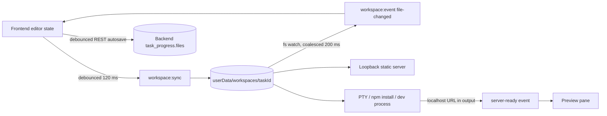

# Local workspace, preview, terminals and runs

The Electron shell gives each open task a real folder on the trainee’s machine. The renderer owns the
editor state and the REST copy of the code; the main process owns the filesystem, a loopback preview
server, pseudo-terminals (PTYs), dev processes and Lighthouse. Nothing in the renderer receives a file
path, a process handle or a token for these resources.

This document describes the implementation in:

- `packages/types/src/desktop.ts` — the authoritative shared API types.
- `desktop/src/preload/index.ts` — the `window.desktop` bridge and IPC channel names.
- `desktop/src/main/workspace/` — `WorkspaceManager`, IPC validation, file mirroring, preview server,
  esbuild bundling, PTYs, process groups, host environment and PostgreSQL setup.
- `frontend/src/runtimes/local/` — the React hooks that consume the API.
- `frontend/src/pages/TaskPage/hooks/useAutosave.ts` and `frontend/src/lib/saveRules.ts` — REST
  autosave and its validation.

For authentication and the REST `/api` proxy, see [authentication](auth.md) and the
[API reference](../api-specifications.md). For the second-screen browser, see [window management](window.md).

## Two copies of the code



- **Editor → disk:** `useLocalWorkspace` calls `workspace:sync` 120 ms after editor changes settle.
  `WorkspaceManager.sync` writes only files whose content differs from the last agreed value, and
  deletes only files that this mirror previously wrote. A file created by a terminal command is never
  deleted merely because the editor has not seen it.
- **Disk → editor:** a recursive filesystem watcher coalesces events for 200 ms, then emits
  `file-changed` when disk content differs from the last value written by the mirror. `content: null`
  means the file was removed. The renderer dispatches `fileEdited`, `fileCreated` or `fileDeleted`.
- **Editor → backend:** the same editor state is separately autosaved to
  `PUT /api/tasks/:taskId/code` with a 2 s debounce, an 8 s maximum wait and a 5 s retry delay. REST
  autosave is how code survives outside the desktop shell and is what a submission reviews. The local
  folder is the runtime copy; it is not a replacement for the REST record.
- Leaving the task route does **not** close the workspace. `WorkspaceSessionContext` closes it when the
  trainee explicitly leaves the task area, preserving `node_modules` during short navigation.

## TypeScript API

These are the exact interfaces in `packages/types/src/desktop.ts`. The optional listeners return an
unsubscribe function.

```ts
type WorkspaceConsoleLevel = 'log' | 'info' | 'warn' | 'error';
type WorkspaceRunKind = 'install' | 'dev';

type WorkspaceEvent =
  | {
      type: 'console';
      taskId: string;
      runId: string;
      level: WorkspaceConsoleLevel;
      args: string[];
      ts: number;
    }
  | { type: 'console-clear'; taskId: string; runId: string }
  | { type: 'preview-ready'; taskId: string; runId: string; url: string }
  | { type: 'file-changed'; taskId: string; path: string; content: string | null }
  | {
      type: 'run-output';
      taskId: string;
      kind: WorkspaceRunKind;
      stream: 'stdout' | 'stderr';
      data: string;
    }
  | { type: 'run-exited'; taskId: string; kind: WorkspaceRunKind; exitCode: number }
  | {
      type: 'server-ready';
      taskId: string;
      port: number;
      url: string;
      terminalId?: string;
    }
  | {
      type: 'server-closed';
      taskId: string;
      port: number;
      terminalId?: string;
    };

type WorkspaceEnvironment = {
  nodeVersion: string | null;
  error: string | null;
};

type WorkspaceOpenInput = {
  taskId: string;
  files: Record<string, string>;
  supportFiles?: Record<string, string>;
};

type WorkspaceOpenResult = WorkspaceEnvironment & {
  previewUrl: string;
};

type WorkspaceSyncInput = WorkspaceOpenInput;

type TerminalOpenInput = { taskId: string; cols: number; rows: number };
type TerminalOpenResult = { terminalId: string; name: string };
type TerminalDataEvent = { taskId: string; terminalId: string; data: string };
type TerminalExitEvent = { taskId: string; terminalId: string; exitCode: number };

const MAX_TERMINALS_PER_TASK = 4;

type LighthouseCategory = 'performance' | 'accessibility' | 'best-practices' | 'seo';

type LighthouseAuditResult = {
  url: string;
  fetchedAt: string;
  scores: Record<LighthouseCategory, number | null>;
  audits: Array<{
    id: string;
    title: string;
    description: string;
    score: number | null;
    displayValue?: string;
    scoreDisplayMode: string;
  }>;
};

interface WorkspaceApi {
  open: (input: WorkspaceOpenInput) => Promise<WorkspaceOpenResult>;
  sync: (input: WorkspaceSyncInput) => Promise<void>;
  reload: (taskId: string) => Promise<Record<string, string>>;
  close: (taskId: string) => Promise<void>;
  getEnvironment: () => Promise<WorkspaceEnvironment>;
  onEvent: (listener: (event: WorkspaceEvent) => void) => () => void;
}

interface TerminalApi {
  open: (input: TerminalOpenInput) => Promise<TerminalOpenResult>;
  write: (taskId: string, terminalId: string, data: string) => Promise<void>;
  resize: (taskId: string, terminalId: string, cols: number, rows: number) => Promise<void>;
  close: (taskId: string, terminalId: string) => Promise<void>;
  onData: (listener: (event: TerminalDataEvent) => void) => () => void;
  onExit: (listener: (event: TerminalExitEvent) => void) => () => void;
}

interface RunApi {
  install: (taskId: string) => Promise<void>;
  dev: (taskId: string, command: string, terminalId?: string) => Promise<void>;
  stop: (taskId: string, terminalId?: string) => Promise<void>;
}

interface AuditApi {
  run: (taskId: string, pagePath?: string) => Promise<LighthouseAuditResult>;
}
```

## IPC channels

Every channel below is registered with `ipcMain.handle` and first calls `assertTrustedSender`, which
checks that the sender frame’s URL has the trusted renderer origin. Event channels are sent only by
main to the main window.

| Direction       | Channel                                                                                                |
| --------------- | ------------------------------------------------------------------------------------------------------ |
| Renderer → main | `workspace:open`, `workspace:sync`, `workspace:reload`, `workspace:close`, `workspace:get-environment` |
| Renderer → main | `terminal:open`, `terminal:write`, `terminal:resize`, `terminal:close`                                 |
| Renderer → main | `run:install`, `run:dev`, `run:stop`, `lighthouse:run`                                                 |
| Main → renderer | `workspace:event`, `terminal:data`, `terminal:exit`                                                    |

`workspace:open` and `workspace:sync` accept `{ taskId, files, supportFiles? }`. `workspace:reload`,
`workspace:close`, `run:install` and `lighthouse:run` take a task id; `lighthouse:run` optionally takes a
page path. `terminal:write` takes `(taskId, terminalId, data)`, `terminal:resize` takes
`(taskId, terminalId, cols, rows)`, and `terminal:close` takes `(taskId, terminalId)`. `run:dev` and
`run:stop` optionally take a terminal id.

## Workspace lifecycle

`app.getPath('userData')/workspaces/<taskId>` is the workspace root. `WorkspaceManager` serializes
lifecycle calls for each task id with a promise chain, so overlapping open/close calls cannot leak a
folder.

1. **Open** validates the task id, resolves and re-checks the root, then empties the folder before
   writing the supplied files. The single preserved path is `.vinkup/db`, the Prisma database; a
   database left behind during cleanup is restored to the fresh folder.
2. `materializeWorkspace` atomically writes each editable text file (temporary file plus rename) and
   records the last agreed contents. `supportFiles` are hidden helpers under `.vinkup/` that bypass the
   editor ignore list; they are used by Prisma tasks.
3. The manager resolves the host environment, prepares PostgreSQL when required, starts the file
   watcher and the loopback preview server, and registers static-preview trust where applicable.
4. Re-opening an existing session writes the incoming files and returns the existing `previewUrl`.
   `open` resolves to `{ previewUrl, nodeVersion, error }`; `error` is a host setup problem such as a
   missing or too-old Node.js, not a rejected promise.
5. **Reload** reads every editable text file back from disk and returns a `Record<string, string>`.
   Ignored paths, binaries and files over the size limit are skipped.
6. **Close** disposes terminals, processes, watcher and server, removes the folder, and preserves
   `.vinkup/db`. During quit, `closeAll` also waits for closes already in progress. Cleanup is bounded
   by a 5-second shutdown timeout so a stuck process cannot block exit.

### Validation and path safety

- Task id: `/^[A-Za-z0-9_-]{1,64}$/`.
- Relative paths: no leading `/`, `\`, NUL, `.`/`..` segments, or non-normalized form; at most 200
  characters. `resolveInsideRoot` re-checks that the resolved path remains inside the root.
- Up to 200 files, at most 200,000 characters per file and 5,000,000 characters in total across an
  open/sync payload. An individual over-large file is skipped; an over-large map is rejected.
- Ignored directories include `node_modules`, `dist`, `build`, `coverage`, `.vite`, `.cache`, `.git`,
  `generated`, `.vinkup` and `.not-committed`. Ignored files include `package-lock.json`, `.DS_Store`
  and `*.log`.
- Files containing NUL, U+FFFD or a known binary extension are not mirrored back into the editor.
- Terminal ids must be UUID-shaped and must belong to the supplied task; dimensions are clamped to
  2–400 columns and 2–200 rows by the PTY layer (IPC input is rounded and clamped to 2–400).
- Terminal input is limited to 16,384 characters per `write`. Run commands are limited to 500
  characters and reject line breaks and NUL.

REST autosave uses the same high-level rules from `frontend/src/lib/saveRules.ts`: 200 files, 200,000
characters per file, 5 MB JSON body, relative paths without `.`/`..`, and no NUL or lone surrogate.
The backend revalidates these in `backend/src/module/task-module/task.schema.ts`.

## Static preview server and in-page bridge

Every workspace gets an HTTP server on `127.0.0.1` with an ephemeral port. `workspace:open` returns its
URL as `previewUrl`. The server serves only files inside the workspace root and sets `no-store`,
`nosniff`, `Referrer-Policy: no-referrer` and `Cross-Origin-Resource-Policy: cross-origin`; because the
preview iframe is sandboxed with an opaque origin, it also sends `Access-Control-Allow-Origin: *`.

Reserved paths:

| Path                                 | Purpose                                                                  |
| ------------------------------------ | ------------------------------------------------------------------------ |
| `/__vinkup/bridge.js`                | Injected console/error/navigation bridge                                 |
| `/__vinkup/bridge-event`             | `POST` endpoint receiving bridge events (body capped at 1,000,000 bytes) |
| `/__vinkup/events`                   | Server-sent events; sends `event: reload` when the editor changes        |
| `/__vinkup/bundle.js?entry=…&mode=…` | esbuild output for a module or classic script                            |

- HTML gets the bridge injected immediately after `<head>` (or at the start of `<body>` when there is
  no head). Relative CSS, JS and image URLs are served normally.
- Module scripts and `.ts` files are bundled in memory with esbuild (`iife`, `es2020`, inline source
  maps). Imports resolve only against workspace files; URL imports and npm packages produce a visible
  build error in the page console. Classic `.ts` scripts are type-stripped while keeping top-level
  names global. Imported CSS is injected into the page.
- The bridge forwards `console` output (levels `log`, `info`, `warn`, `error`), runtime errors and
  `preview-ready` to `workspace:event`. It caps values at 2,000 characters, depth at 3, and console
  messages at 500 per page. Console arguments are strings when they reach the renderer.
- `/favicon.ico` returns `204` to avoid a Lighthouse Best Practices penalty from a missing icon.

The app-managed server is trusted for a _static_ preview only for courses whose id starts with
`html`, `css` or `js` (`usesTrustedStaticPreview`). React and other Node courses keep using a real dev
server discovered from terminal output; SQL has no loopback preview. Trust is revoked as soon as the
server closes or the workspace is disposed, so a recycled port cannot inherit it.

## Terminals and process execution

`terminal:open` starts a real login shell through `node-pty` with `TERM=xterm-256color`. A generated
minimal rc file keeps the first prompt short. At most four terminals can be open per task; each has a
UUID id and a stable display name `T1`, `T2`, … independent of the id. Output and exit events carry both
the task id and terminal id, so a late event from a closed workspace can be ignored.

`run:install` spawns `npm install --no-audit --no-fund` in the workspace. A successful install is
remembered by the exact `package.json` contents, so revisiting a task reports exit code 0 without
reinstalling. Output arrives as `run-output` events with `kind: 'install'`; completion arrives as
`run-exited`.

`run:dev` validates the command, splits it with a small shell-like parser (quotes and backslash
escapes; no shell), and either:

- writes Ctrl+C followed by the command into the selected PTY, using it as the visible shell; or
- when no shell is open, spawns a detached process group so children can be terminated together.

`run:stop` stops the fallback process when no terminal id is supplied (the legacy behavior), or sends
Ctrl+C to the selected terminal. Closing a terminal kills only the servers owned by that terminal.
Spawned processes receive signal exit codes as `128 + signal` and are terminated with `SIGTERM`, then
`SIGKILL` after a grace period.

Dev servers are discovered by scanning ANSI-stripped output for `localhost` or `127.0.0.1` URLs. A
candidate port is announced as `server-ready` only after a loopback TCP connection succeeds (up to
10 s); it is monitored every 2 s and emits `server-closed` after two failed checks. The port is also
registered with the Resources browser allowlist while active, and forgotten so a later server can
reuse the port.

## Host environment and PostgreSQL

`workspace:get-environment` returns `{ nodeVersion, error }`. The main process resolves the login
shell `PATH` once (merging it with Electron’s inherited `PATH`), verifies `node --version`, and requires
Node.js 22 or newer. A missing or old Node.js produces a renderer error card rather than a bundled
runtime.

Trainee processes receive only an allowlist of environment keys (`PATH`, `HOME`, `LANG`, `LC_ALL`,
`LC_CTYPE`, `TERM`, `NODE_ENV`, `SHELL`, `USER`, `LOGNAME`, `TMPDIR`, `TEMP`, `TMP`, `XDG_CACHE_HOME`,
`XDG_CONFIG_HOME`, `XDG_DATA_HOME`). API tokens, cookies and the desktop session never cross into a
shell or dev process.

PostgreSQL is required for every `postgresql` course task and for Prisma tasks whose `package.json`
does not depend on `prisma-pglite`. `VINKUP_DATABASE_URL` may point to a different local server;
otherwise the app connects over `/var/run/postgresql` with peer authentication. The manager verifies
the server, creates the course database and a separate `_test` database when needed, and injects
`DATABASE_URL` and `VINKUP_TEST_DATABASE_URL` into the task environment. Setup failures are reported as
actionable `PostgresUnavailableError` messages in the Result pane.

## Lighthouse audit

`audit.run(taskId, pagePath?)` invokes `lighthouse:run`. Main resolves the task’s preview URL, builds
the audit URL with the optional page path, and returns `LighthouseAuditResult` with numeric scores for
`performance`, `accessibility`, `best-practices` and `seo` plus the individual audit entries. The task
workspace must be open; the channel rejects an unknown or invalid task id.

## REST code endpoints used alongside the local workspace

| Method | Endpoint                  | Authentication / authorization  | Response               |
| ------ | ------------------------- | ------------------------------- | ---------------------- |
| `GET`  | `/api/tasks/:taskId/code` | Authenticated trainee, own task | `200 TaskCodeResponse` |
| `PUT`  | `/api/tasks/:taskId/code` | Authenticated trainee, own task | `204` with no body     |

```ts
type TaskCodeResponse = { files: TaskFile[]; updatedAt: string | null };
type SaveCodeRequest = { files: TaskFile[] };
type TaskFile = { path: string; content: string };
```

Mentors use the read-only
`GET /api/admin/trainees/:traineeId/tasks/:taskId/code` route to inspect submitted files. The desktop
renderer calls these through the shared Axios client (`baseURL: '/api'`, cookies included), which the
Electron main process proxies to the backend; there is no separate code IPC channel.

## Resources browser and allowlist

`window.desktop.resources` embeds a navigable browser for the Resources page. Navigation is resolved in
the main process against `ResourcesAllowlist` from `packages/types/src/resources.ts`; the renderer
cannot bypass it by setting an `iframe` URL.

```ts
interface ResourcesAllowlist {
  version: number;
  updatedAt: string;
  domains: string[];
  categories: { id: string; label: string; domains: string[] }[];
  descriptions: Record<string, string>;
}

interface ResourcesBrowserState {
  url: string;
  title: string;
  isLoading: boolean;
  canGoBack: boolean;
  canGoForward: boolean;
  isHome: boolean;
  isBlocked: boolean;
  blockedUrl: string | null;
  blockedHost: string | null;
  error: string | null;
  errorKind: 'offline' | 'unreachable' | 'refused' | 'unknown' | null;
  zoom: number;
}
```

The API exposes `getAllowlist`, `getState`, `open(bounds)`, `setBounds(bounds)`, `close`, `home`,
`navigate(input)`, `goBack`, `goForward`, `reload`, `stop`, `find(query)`, `findNext(forward)`,
`stopFind`, `zoomIn`, `zoomOut`, `zoomReset` and the subscription methods `onChange`, `onFocusAddress`,
`onOpenFind`, `onFindResult`, `onEscape` and `onActivity`. `close` hides the browser but keeps the
page alive; `home` returns to the approved-sites start page without clearing history.

| Direction       | Channels                                                                                                                                                                                                                                                                                                                                                              |
| --------------- | --------------------------------------------------------------------------------------------------------------------------------------------------------------------------------------------------------------------------------------------------------------------------------------------------------------------------------------------------------------------- |
| Renderer → main | `resources:get-allowlist`, `resources:get-state`, `resources:open`, `resources:set-bounds`, `resources:close`, `resources:home`, `resources:navigate`, `resources:back`, `resources:forward`, `resources:reload`, `resources:stop`, `resources:find`, `resources:find-next`, `resources:stop-find`, `resources:zoom-in`, `resources:zoom-out`, `resources:zoom-reset` |
| Main → renderer | `resources:state-changed`, `resources:focus-address`, `resources:open-find`, `resources:find-result`, `resources:escape`, `resources:activity`                                                                                                                                                                                                                        |

`loadResourcesAllowlist()` in `desktop/src/main/resources/allowlist-source.ts` uses the highest
**valid** version of three sources:

1. the bundled `desktop/resources/resources-allowlist.json`;
2. a cached last-accepted remote copy in `userData`;
3. a remote JSON document fetched with a 4-second timeout.

A malformed remote document, a failed fetch or an older `version` is ignored; the browser always has a
usable list. Hosts match exactly or as subdomains. Loopback hosts are allowed only at app-managed ports: fixed dev
services that answer a probe, workspace dev servers reported as `server-ready`, and registered static
preview servers. The default remote URL is
`<api>/api/resources/allowlist`; set `VINKUP_RESOURCES_ALLOWLIST_URL` to another URL or to an empty
string to override or disable remote updates. There is currently no backend route mounted at that
default path, so normal operation uses the bundled or cached list. Secondary display windows mirror
these calls through `window.vinkupDisplay.resources` and `secondary-resources:*` channels; see
[window management](window.md).

## Current limitations

- Recursive filesystem watching is best effort: filesystems that do not support it still mirror
  editor saves to disk, but terminal-created files need `workspace:reload`.
- The desktop shell does not flush accumulated activity time immediately before quit.
- Local workspaces require the Electron shell. `window.desktop` is absent in a plain browser, so
  `useLocalWorkspace` reports "Local workspaces are only available in the desktop app."
